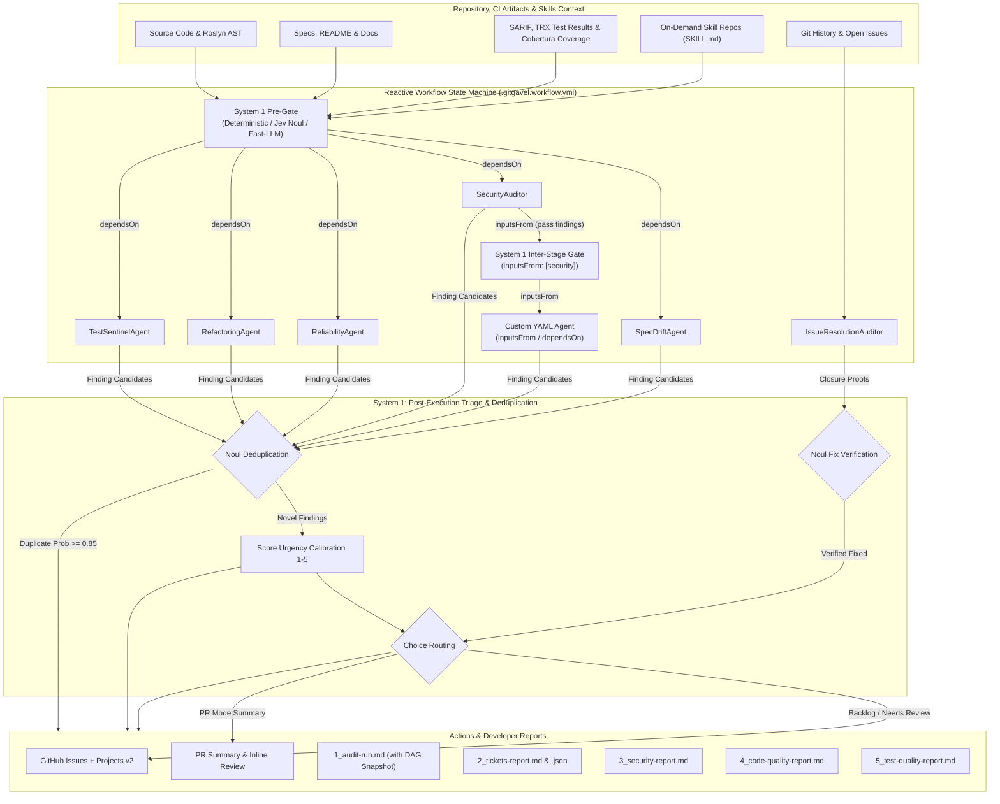

# GitGavel ⚖️

> **Multi-Agent AI Repository Auditor & Backlog Sentinel**  
> Powered by a reactive **System 1 + System 2 Workflow DAG**, **Declarative YAML Agents**, **On-Demand Skill Repositories**, **CI Pipeline Artifact Ingestion**, and **[TypeSafe Jev](https://typesafe.ai) + Deterministic / Fast-LLM Gates**.

[](https://dotnet.microsoft.com/)
[](https://typesafe.ai)
[](https://ai.google.dev/)
[](Dockerfile)

---

## Overview

Software repositories suffer from invisible technical debt: specification drift between documentation and code, creeping architectural complexity, and subtle security vulnerabilities that accumulate unnoticed.

**GitGavel** acts as an autonomous, customizable backlog sentinel:
1. **Reactive Workflow DAG & State Machine (`.gitgavel.workflow.yml`)**:
   * Automatically resolves **parallel vs. series** execution across both **System 1** (gates/filters) and **System 2** (LLM subagents) using `inputsFrom` (wait + pass upstream findings) and `dependsOn` (wait for completion only, no findings passed).
   * Enforces **bounded concurrency** (`maxParallelSteps`, `maxPerProvider`, `critical-path` scheduling) to prevent API rate-limiting (`HTTP 429`) and memory spikes.
   * Renders a **Live Console Workflow & Agent Status Diagram** in real time (`⚪ Not Used`, `⏳ Waiting`, `🟢 Queued`, `⏭️ Skipped`, `🔄 Running`, `✅ Completed`, `❌ Failed`).
2. **System 1 (Multi-Engine Gating & Post-Execution Triage)**:
   * **Pre-Execution & Inter-Stage Gating**: Supports **Deterministic Rule & Artifact Gates** (`deterministic`), **Fast-LLM Gates** (`llm`), **TypeSafe Jev Gates** (`jev` via `Noul`), or **`deterministic-then-jev`** (default), slashing unnecessary LLM token usage by up to 80%.
   * **Post-Execution Finding & Closure Triage**: Evaluates semantic deduplication (`Noul`), urgency/blast radius calibration (`Score` 1–5), issue resolution proof verification, and destination routing (`Choice`).
3. **System 2 (Declarative YAML Standard & Custom Subagents)**:
   * Standard subagents (`SpecDriftAgent`, `SecurityAuditor`, `ReliabilityAgent`, `RefactoringAgent`, `TestSentinelAgent`, `IssueResolutionAuditor`) and custom project-specific subagents are driven by unified declarative YAML definitions (`DeclarativeYamlAgent`).
   * Eject and customize built-in agent prompts, scopes, and gates at any time with `gitgavel init --eject-agents`.
4. **CI Pipeline Artifact Ingestion & On-Demand Agent Skills**:
   * **Current Run Artifacts (`artifacts:`)**: Ingests `.trx`, `junit`, `cobertura`, `lcov`, `sarif`, and build log files from upstream CI jobs to give gates and agents concrete test failure, coverage, and static analysis evidence.
   * **Multi-Repository Skills (`skills:`)**: Shallow-clones external or local skill repositories (`SKILL.md` playbooks) on-demand during pipeline execution and injects assigned skills into each agent's prompt.
5. **Developer Reporting & GitHub Projects (v2) Automation**:
   * Emits 5 markdown reports, machine-readable JSON, sticky Pull Request summaries, inline PR review comments, and GitHub Actions step summaries.
   * Publishes deduplicated GitHub issues, closes verified fixed issues, and updates Projects v2 Kanban boards via GraphQL.

---

## Architecture



---

## Quickstart

### Prerequisites
- [.NET 10 SDK](https://dotnet.microsoft.com/download/dotnet/10.0)
- (Optional) [Docker](https://www.docker.com/) for containerized audits

### 1. Installation
Clone the repository:
```bash
git clone https://github.com/tyronebramwell/GitGavel.git
cd GitGavel
```

### 2. Configure Environment Secrets
Copy the environment template and populate your API credentials:
```bash
cp .env.example .env
```

Edit `.env`:
```env
# Required for live LLM subagents (Google Gemini / OpenAI / Anthropic)
GEMINI_API_KEY=your_gemini_api_key_here

# Required for live System 1 Triage Gatekeeper (TypeSafe Jev)
JEV_API_KEY=your_jev_api_key_here

# Required for publishing GitHub Issues & Projects v2 mutations
GH_TOKEN=your_github_personal_access_token_here
```

### 3. Run an Audit

```bash
# Dry run with full live Gemini & Jev triage (safe preview, no GitHub writes)
dotnet run --project src/GitGavel -- audit --dry-run

# Offline mock mode (runs without API keys)
dotnet run --project src/GitGavel -- audit --dry-run --mock

# Offline subagents + live TypeSafe Jev triage
dotnet run --project src/GitGavel -- audit --dry-run --mock-llm

# Run with a custom workflow DAG and custom agents directory
dotnet run --project src/GitGavel -- audit --workflow .gitgavel.workflow.yml --agents .gitgavel/agents

# Eject built-in YAML agent definitions and workflow DAG for local customization
dotnet run --project src/GitGavel -- init --eject-agents --eject-workflow
```

---

## CLI Commands

GitGavel provides three Spectre.Console-powered CLI verbs:

| Command | Description |
| :--- | :--- |
| `audit` | Run full repository audit pipeline (Workflow DAG execution + System 1 triage + reporting). |
| `init` | Scaffold `.gitgavel.yml`, eject standard `*.agent.yml` prompts (`--eject-agents`), or eject `.gitgavel.workflow.yml` (`--eject-workflow`). |
| `validate` | Validate `.gitgavel.yml`, workflow DAG topology (cycle/dependency checks), agent definitions, and API connectivity. |

### Command Options (`audit`)
- `-c, --config <PATH>`: Path to `.gitgavel.yml` configuration file (default: `.gitgavel.yml`).
- `-w, --workflow <PATH>`: Optional path to separate `.gitgavel.workflow.yml` DAG workflow definition file.
- `--agents <PATH>`: Optional path to directory or file containing declarative `*.agent.yml` definitions.
- `--max-concurrency <COUNT>`: Override maximum parallel System 2 workflow steps.
- `-d, --dir <PATH>`: Target repository directory to audit (default: `.`).
- `-r, --repo <OWNER/REPO>`: Target GitHub repository coordinates (e.g. `octocat/Hello-World`).
- `--pr <NUMBER>`: Optional Pull Request number to audit for PR reviews and domain reports.
- `--allow-external-paths`: Explicitly permit configuration, SARIF, or reporting paths outside the repository root.
- `--all-agents, --no-gate`: Bypass pre-execution subagent gating and execute all enabled subagents unconditionally.
- `--dry-run`: Skip creating GitHub issues and modifying Projects v2 boards.
- `--mock`: Run with simulated subagents and mock triage.
- `--mock-llm`: Run with simulated subagents while keeping the live TypeSafe Jev decision engine active.

### Command Options (`init`)
- `-o, --output <PATH>`: Output path for generated `.gitgavel.yml`.
- `--eject-agents`: Export standard built-in agent YAML files (`spec-drift.agent.yml`, `security.agent.yml`, `reliability.agent.yml`, `refactoring.agent.yml`, `test-sentinel.agent.yml`, `issue-resolution.agent.yml`) to `.gitgavel/agents/`.
- `--eject-workflow`: Export the default `.gitgavel.workflow.yml` DAG definition to the repository root.
- `-f, --force`: Overwrite existing configuration or ejected files.

---

## Live Console Workflow & Agent Status Diagram

During `gitgavel audit`, GitGavel renders a live DAG execution diagram showing every workflow stage grouped by topological level, concurrency slot utilization, dependency edges (`inputsFrom` vs. `dependsOn`), and real-time node statuses:

```text
╭─ GitGavel Workflow Execution DAG (Default Parallel Discovery Workflow) ──────────────────────╮
│ Concurrency: 2 / 3 slots active | Completed: 2/7 | Running: 2 | Queued: 1 | Skipped: 1      │
│                                                                                              │
│ Level 0 (Root)                                                                               │
│ └── ✅ Pre-Execution Subagent Gate [system1:deterministic-then-jev] (0.1s)                   │
│                                                                                              │
│ Level 1 (dependsOn: [pre-gate])                                                              │
│ ├── ⏭️ SpecDriftAgent [system2:gemini-2.5-pro] — Skipped: No spec files modified             │
│ ├── ✅ SecurityAuditor [system2:gemini-2.5-pro] (4.1s, 2 findings, 610 tok)                  │
│ ├── 🔄 ReliabilityAgent [system2:gemini-3.1-pro-preview] (running 3.4s...)                   │
│ ├── 🔄 RefactoringAgent [system2:gemini-2.5-flash] (running 3.4s...)                         │
│ ├── 🟢 TestSentinelAgent [system2:gemini-2.5-pro] — Queued (waiting for concurrency slot)    │
│ └── ⚪ IssueResolutionAuditor [system2:gemini-2.5-flash] — Not Used (disabled)               │
╰──────────────────────────────────────────────────────────────────────────────────────────────╯
```

---

## Configuration

### 1. Main Configuration (`.gitgavel.yml`)

```yaml
version: 1

# Optional separate workflow DAG file (defaults to parallel fan-out if omitted)
workflowFile: ".gitgavel.workflow.yml"

scope:
  specs:
    include:
      - "SPECIFICATION.md"
      - "README.md"
      - "Dockerfile"
      - "action.yml"
      - "docs/**/*.md"
  source:
    include:
      - "**/*.cs"
      - "**/*.ts"
      - "**/*.py"
    exclude:
      - "**/bin/**"
      - "**/obj/**"
      - "**/*.Tests/**"
      - "**/.git/**"
  tests:
    include:
      - "**/*.Tests/**"
      - "tests/**"

# Ingest current CI run artifacts (TRX, JUnit, Cobertura, LCOV, SARIF, Logs)
artifacts:
  enabled: true
  sources:
    - name: "dotnet-test-results"
      type: "trx"
      paths: ["artifacts/tests/**/*.trx"]
    - name: "code-coverage"
      type: "cobertura"
      paths: ["artifacts/tests/**/coverage.cobertura.xml"]
    - name: "sast-sarif"
      type: "sarif"
      paths: ["artifacts/sarif/*.sarif"]

# Fetch external or local agent skills on-demand during pipeline execution
skills:
  enabled: true
  cacheDir: ".gitgavel/cache/skills"
  repositories:
    - name: "org-skills"
      url: "https://github.com/my-org/engineering-skills.git"
      ref: "main"
      paths: ["skills/dotnet-reliability", "skills/owasp-top-10"]

subagents:
  apiKeyEnv: "GEMINI_API_KEY"
  timeoutSeconds: 300
  definitionsPath: ".gitgavel/agents"   # Optional directory of *.agent.yml overrides & custom agents
  specDrift:
    enabled: true
    provider: "gemini"
    model: "gemini-2.5-pro"
  security:
    enabled: true
    provider: "gemini"
    model: "gemini-2.5-pro"
    sarifReports: ["artifacts/sarif/semgrep.sarif", "artifacts/sarif/trivy.sarif"]
    artifacts: ["sast-sarif"]
    skills: ["org-skills/owasp-top-10"]
  reliability:
    enabled: true
    provider: "gemini"
    model: "gemini-3.1-pro-preview"
    artifacts: ["dotnet-test-results"]
    skills: ["org-skills/dotnet-reliability"]
  refactoring:
    enabled: true
    provider: "gemini"
    model: "gemini-2.5-flash"
  tests:
    enabled: true
    provider: "gemini"
    model: "gemini-2.5-pro"
    tiers: ["unit", "integration", "e2e"]
    artifacts: ["dotnet-test-results", "code-coverage"]
  issueResolution:
    enabled: true
    provider: "gemini"
    model: "gemini-2.5-flash"
    autoCloseCompleted: true

triage:
  engine: "jev"
  subagentGating:
    enabled: true
    engine: "deterministic-then-jev"    # deterministic-then-jev | deterministic | jev | llm
    minConfidence: 0.50
    alwaysRunSecurityOnSarifAlerts: true
    alwaysRunSpecDriftOnSpecChanges: true
  jev:
    apiKeyEnv: "JEV_API_KEY"
    thresholds:
      autoBacklogConfidence: 0.85
      humanReviewConfidence: 0.50
      autoCloseIssueConfidence: 0.90
    dedupeWithNoul: true
  maxIssuesPerRun: 4
```

### 2. Reactive Workflow DAG (`.gitgavel.workflow.yml`)

Define parallel and series stages across System 1 gates and System 2 agents:
- **`inputsFrom: [nodeId]`**: Waits for upstream node(s) AND passes their `FindingCandidate` outputs into this stage.
- **`dependsOn: [nodeId]`**: Waits for upstream node(s) to finish for ordering only, passing **no** findings into this stage.

```yaml
version: 1
name: "Custom Parallel & Series Audit DAG"

concurrency:
  maxParallelSteps: 3
  schedulingPolicy: "critical-path"
  maxPerProvider:
    gemini: 3

nodes:
  - id: "pre-gate"
    name: "Pre-Execution Gate"
    system: "system1"
    engine: "deterministic-then-jev"
    type: "subagent-gating"
    passResults: true

  - id: "security"
    agent: "security"
    system: "system2"
    dependsOn: ["pre-gate"]
    passResults: true

  - id: "high-sev-filter"
    name: "High Severity Filter"
    system: "system1"
    engine: "deterministic"
    inputsFrom: ["security"]
    condition: "inputs.findingsCount(severity >= 'High') > 0"
    passResults: true

  - id: "remediationVerifier"
    agent: "remediationVerifier"
    system: "system2"
    inputsFrom: ["high-sev-filter"]    # Runs in series after security -> high-sev-filter with findings
    passResults: true
```

---

## Developer Reporting Engine

Every audit run generates 5 structured developer reports in `./reports/`:

1. **`1_audit-run.md`**: Executive summary, run duration, LOC scanned, token counts, Workflow DAG execution table (final status, level, dependencies, findings, and reasons for every node), pre-execution gating diagnostics, and triage funnel metrics.
2. **`2_tickets-report.md` & `.json`**: Actionable tickets accepted to Backlog or routed to Review, with calibrated urgency scores.
3. **`3_security-report.md`**: Security vulnerability catalog, OWASP classifications, attack vectors, and verified code remediations.
4. **`4_code-quality-report.md`**: Spec drift catalog, reliability & performance analysis, Roslyn AST cyclomatic complexity hotspots, and refactoring catalog.
5. **`5_test-quality-report.md`**: Test pyramid completeness across Unit, Integration, and E2E tiers with extra scenario recommendations.

---

## GitHub Actions CI & Audit Pipeline

In [`.github/workflows/ci.yml`](.github/workflows/ci.yml), `build-and-test` and `security-and-infra` run in parallel to produce `.trx` test results, Cobertura code coverage, and Roslyn/Semgrep/Trivy/Gitleaks/Hadolint SARIF artifacts. Once both jobs finish, the `audit` job downloads those evidence artifacts into `./artifacts/` and runs GitGavel.

---

## Testing

Run the full xUnit test suite (**288 unit & integration tests** covering workflow DAG state transitions, bounded concurrency, non-Jev gates, skill resolution, CI artifact ingestion, SARIF 1.0/2.1 parsing, declarative YAML agents, and reporters):
```bash
dotnet test
```
