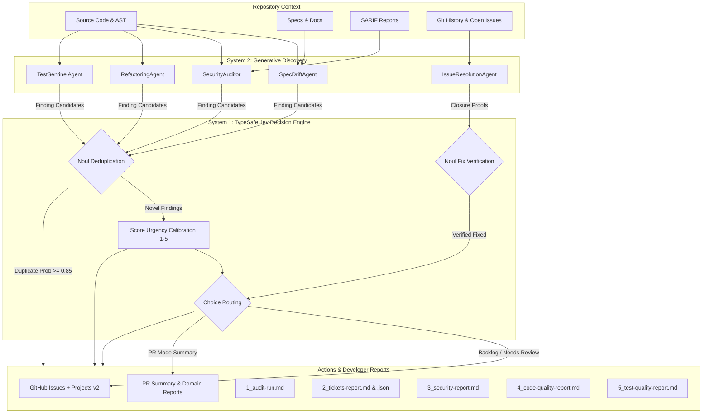

# GitGavel ⚖️

> **Multi-Agent AI Repository Auditor & Backlog Sentinel**  
> Powered by hybrid **System 2** (Generative Subagents) & **System 1** ([TypeSafe Jev](https://typesafe.ai) Decision Engine).

[](https://dotnet.microsoft.com/)
[](https://typesafe.ai)
[](https://ai.google.dev/)
[](Dockerfile)

---

## Overview

Software repositories suffer from invisible technical debt: specification drift between documentation and code, creeping architectural complexity, and subtle security vulnerabilities that accumulate unnoticed.

**GitGavel** acts as an autonomous backlog sentinel:
1. **System 2 (Generative Discovery)**: Dispatches specialized LLM subagents in parallel to audit specification divergence, static security advisories (SARIF), Roslyn-analyzed architectural hotspots, automated test completeness, and completed issue verification.
2. **System 1 (TypeSafe Jev Decision Engine)**: Gates findings through deterministic, probabilistic decision intelligence—evaluating semantic deduplication (`Noul`), urgency/blast radius calibration (`Score` 1–5), issue resolution proof verification, and destination routing (`Choice`).
3. **Developer Reporting Engine**: Emits 5 markdown reports, machine-readable JSON, sticky Pull Request summaries, and GitHub Actions step summaries.
4. **GitHub Projects (v2) Automation**: Publishes deduplicated GitHub issues tagged with deterministic metadata comments, closes verified fixed issues, and updates Projects v2 Kanban boards via GraphQL.

---

## Architecture



---

## Quickstart

### Prerequisites
- [.NET 10 SDK](https://dotnet.microsoft.com/download/dotnet/10.0)
- (Optional) [Docker](https://www.docker.com/) for containerized audits

### 1. Installation
Clone the repository:
```bash
git clone https://github.com/tyronebramwell/GitGavel.git
cd GitGavel
```

### 2. Configure Environment Secrets
Copy the environment template and populate your API credentials:
```bash
cp .env.example .env
```

Edit `.env`:
```env
# Required for live LLM subagents (Google Gemini 2.5)
GEMINI_API_KEY=your_gemini_api_key_here

# Required for live System 1 Triage Gatekeeper (TypeSafe Jev)
JEV_API_KEY=your_jev_api_key_here

# Required for publishing GitHub Issues & Projects v2 mutations
GH_TOKEN=your_github_personal_access_token_here
```

### 3. Run an Audit

```bash
# Dry run with full live Gemini & Jev triage (safe preview, no GitHub writes)
dotnet run --project src/GitGavel -- audit --dry-run

# Offline mock mode (runs without API keys)
dotnet run --project src/GitGavel -- audit --dry-run --mock

# Offline subagents + live TypeSafe Jev triage
dotnet run --project src/GitGavel -- audit --dry-run --mock-llm

# Live execution against a target GitHub repository
dotnet run --project src/GitGavel -- audit --repo owner/repo
```

---

## CLI Commands

GitGavel provides three Spectre.Console-powered CLI verbs:

| Command | Description |
| :--- | :--- |
| `audit` | Run full repository audit pipeline (System 2 discovery + System 1 Jev triage + reporting). |
| `init` | Interactively scaffold a starter `.gitgavel.yml` configuration file. |
| `validate` | Perform schema validation and test connectivity to Gemini, Jev, and GitHub APIs. |

### Command Options (`audit`)
- `-c, --config <PATH>`: Path to `.gitgavel.yml` configuration file (default: `.gitgavel.yml`).
- `-d, --dir <PATH>`: Target repository directory to audit (default: `.`).
- `-r, --repo <OWNER/REPO>`: Target GitHub repository coordinates (e.g. `octocat/Hello-World`).
- `--pr <NUMBER>`: Optional Pull Request number to audit for PR reviews and domain reports.
- `--allow-external-paths`: Explicitly permit configuration, SARIF, or reporting paths outside the repository root.
- `--dry-run`: Skip creating GitHub issues and modifying Projects v2 boards.
- `--mock`: Run with simulated subagents and mock triage.
- `--mock-llm`: Run with simulated subagents while keeping the live TypeSafe Jev decision engine active.

---

## Configuration (`.gitgavel.yml`)

```yaml
version: 1

scope:
  specs:
    include:
      - "SPECIFICATION.md"
      - "docs/**/*.md"
      - "specs/**/*.md"
      - "api/openapi.json"
  source:
    include:
      - "**/*.cs"
      - "**/*.ts"
      - "**/*.py"
    exclude:
      - "**/bin/**"
      - "**/obj/**"
      - "**/*.Tests/**"
      - "**/.git/**"
  tests:
    include:
      - "**/*.Tests/**"
      - "tests/**"
      - "**/*.spec.*"
      - "**/*.test.*"

subagents:
  apiKeyEnv: "AI_API_KEY"
  timeoutSeconds: 300                 # Request timeout for LLMs (default: 300s / 5 mins)
  specDrift:
    enabled: true
    provider: "gemini"
    model: "gemini-2.5-pro"
  security:
    enabled: true
    provider: "gemini"
    model: "gemini-2.5-pro"
    sarifReports: ["reports/semgrep.sarif"]
  reliability:
    enabled: true                     # Phase 8: Reliability & Performance Subagent
    provider: "gemini"
    model: "gemini-3.1-pro-preview"
  refactoring:
    enabled: true
    provider: "gemini"
    model: "gemini-2.5-flash"
  tests:
    enabled: true
    provider: "gemini"
    model: "gemini-2.5-pro"
    tiers: ["unit", "integration", "e2e"]
  issueResolution:
    enabled: true
    provider: "gemini"
    model: "gemini-2.5-flash"
    autoCloseCompleted: true

triage:
  engine: "jev"
  jev:
    apiKeyEnv: "JEV_API_KEY"
    thresholds:
      autoBacklogConfidence: 0.85
      humanReviewConfidence: 0.50
      autoCloseIssueConfidence: 0.90
    dedupeWithNoul: true
  maxIssuesPerRun: 4

reporting:
  outputDir: "./reports"
  githubStepSummary: true
  formats:
    - "markdown"
    - "json"
  reports:
    auditRun: true
    tickets: true
    security: true
    codeQuality: true
    testQuality: true

github:
  labels:
    - "ai-backlog"
  pullRequests:
    enabled: true
    onlyChangedFiles: true
    auditExistingReviews: true
    postSummaryComment: true
    defaultReviewEvent: "COMMENT"
  issueClosure:
    enabled: true
    stateReason: "completed"
  projectsV2:
    enabled: true
    projectNumber: 2
    columns:
      backlog: "Backlog"
      humanReview: "AI Triage"
      done: "Done"
      discard: "Discarded"
    fields:
      priority: "Priority"
```

---

## Developer Reporting Engine

Every audit run generates 5 structured developer reports in `./reports/`:

1. **`1_audit-run.md`**: Executive summary, run duration, LOC scanned, token counts, and Jev funnel metrics.
2. **`2_tickets-report.md` & `.json`**: Actionable tickets accepted to Backlog or routed to Review, with calibrated Jev urgency scores.
3. **`3_security-report.md`**: Security vulnerability catalog, OWASP classifications, attack vectors, and verified code remediations.
4. **`4_code-quality-report.md`**: Spec drift catalog, Roslyn AST cyclomatic complexity hotspots, and refactoring catalog.
5. **`5_test-quality-report.md`**: Test pyramid completeness across Unit, Integration, and E2E tiers with extra scenario recommendations.

---

## GitHub Actions Automation

Run GitGavel automatically on a weekly schedule using the included action:

```yaml
# .github/workflows/audit.yml
name: "Weekly AI Backlog Audit"

on:
  schedule:
    - cron: '0 3 * * 1' # Every Monday at 03:00 UTC
  workflow_dispatch:

permissions:
  issues: write
  contents: read
  repository-projects: write

jobs:
  audit:
    runs-on: ubuntu-latest
    steps:
      - uses: actions/checkout@v4
      - name: Run GitGavel Sentinel
        uses: ./
        with:
          config_path: .gitgavel.yml
        env:
          GH_TOKEN: ${{ secrets.GH_TOKEN }}
          GEMINI_API_KEY: ${{ secrets.GEMINI_API_KEY || secrets.AI_API_KEY }}
          AI_API_KEY: ${{ secrets.AI_API_KEY || secrets.GEMINI_API_KEY }}
          JEV_API_KEY: ${{ secrets.JEV_API_KEY }}
      - name: Upload Audit Reports
        uses: actions/upload-artifact@v4
        if: always()
        with:
          name: gitgavel-reports
          path: ./reports/
```

---

## Testing

Run the full xUnit test suite (22 unit tests across all 4 phases):
```bash
dotnet test
```
