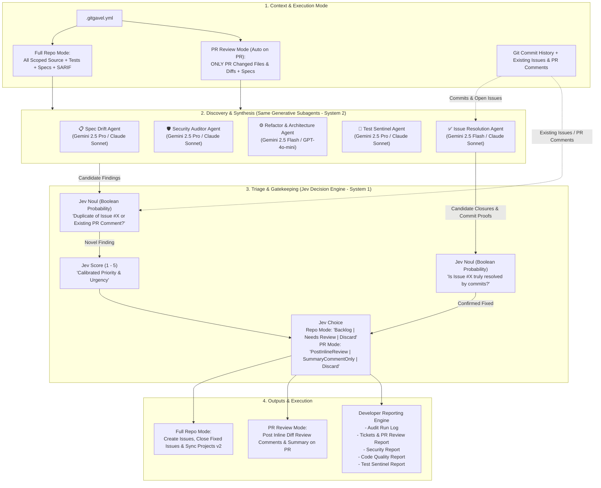

# Technical Specification: Multi-Agent AI Repo Auditor & Backlog Sentinel ("GitGavel")

## 1. Executive Summary

**GitGavel** is an automated repository and pull request audit tool designed to run in continuous integration (CI) or as a standalone CLI. It employs a **hybrid System 1 + System 2 multi-agent architecture** that operates across two execution modes using the **same specialized subagents**:

* **System 2 (Generative Subagents)**: Deep reasoning agents (powered by Claude/Gemini/OpenAI) audit across specification alignment (`SpecDriftAgent`), security posture (`SecurityAuditorAgent`), code architecture (`RefactoringAgent`), automated test completeness (`TestSentinelAgent`), and open issue completion (`IssueResolutionAgent`).
  * In **Full Repository Audit Mode** (scheduled/manual runs), the subagents audit the full repository scope to maintain the engineering backlog and close completed issues.
  * In **Pull Request Review Mode** (auto-triggered on every PR), the **same subagents** run strictly against the **files and diffs changed in the Pull Request**, generating targeted inline PR review comments and a PR review summary.
* **System 1 (Jev Decision Engine)**: A fast, probabilistic decision engine (powered by TypeSafe Jev) validates candidate findings and issue resolution proofs in milliseconds—performing pairwise duplicate checks against existing issues or existing PR review comments via `Noul` probabilities, verifying completed issues via `Noul`, calibrating urgency scoring via `Score`, and routing findings to **GitHub Projects (v2)** columns (`Backlog`, `AI Triage`, `Done`, `Discard`) or **GitHub Pull Request Reviews** (`PostInlineReview`, `SummaryCommentOnly`, `Discard`) via `Choice`.
* **Developer Reporting Engine**: Emits dedicated, structured reports (Run Log, Tickets & PR Review Report, Security Report, Code Quality Report, Test Sentinel Report) available both locally and as GitHub Action Step Summaries and downloadable CI artifacts.

---

## 2. Core Objectives & Non-Goals

### Objectives
- **Multi-Domain Specialization**: Dedicated subagents for Spec Drift, Security, Architecture/Refactoring, Automated Testing, and Issue Resolution Verification to eliminate prompt dilution across both repository audits and PR reviews.
- **Unified Agent Pipeline for PR Reviews (Diff-Only Scope)**: Automatically runs on every Pull Request, scoping the `SpecDrift`, `Security`, `Refactoring`, and `TestSentinel` subagents strictly to the **changes in the PR** (modified files and diff hunks) and posting their triaged findings as inline PR review comments and a summary comment on the Pull Request.
- **Comprehensive Test Pyramid Auditing**: Automated detection of missing unit, integration, and end-to-end (E2E) tests, extra scenario coverage, and test reliability improvements.
- **Automated Completed Issue Closure**: Continuous verification of open GitHub issues against the current codebase and git commit history, automatically closing resolved issues with an explanatory comment detailing how the issue was fixed and referencing the specific commit SHAs.
- **Probabilistic Gatekeeping with Jev**: Sub-second triage, calibrated confidence scoring, high-confidence issue closure verification, and automated routing to an "Unsure / Maintainer Review" queue when confidence is borderline.
- **Pairwise Deduplication via Jev `Noul`**: Probabilistic duplicate detection against existing issues and existing PR review comments without expensive generative LLM calls.
- **Developer-Centric Reporting**: Comprehensive developer reports for pipeline logs, created/closed tickets, PR review actions, security posture, architectural health, and automated test coverage.
- **Zero-Infra Context Routing**: Avoids external vector databases in favor of deterministic AST, git history, PR diff, and targeted file routing.
- **GitHub Projects (v2) Automation**: Seamless GraphQL automation mapping findings and resolved issues directly to project columns (`Backlog`, `AI Triage`, `Done`, `Discard`).
- **Container-First Distribution**: Packaged as a self-contained, trimmed .NET 10 Alpine container image.

### Non-Goals
- **Autonomous Code Commits**: The tool will not auto-commit code changes or merge pull requests; its boundary is backlog ticket lifecycle management (creating, updating, and closing resolved issues) and Pull Request review commenting.
- **External Vector DB Hosting**: No hosted vector DBs or cold embedding passes in CI; context routing is handled via file patterns, git commit history, PR diffs, and AST inspection.

---

## 3. Hybrid System 1 + System 2 Architecture



---

## 4. Specialized Subagents & Execution Modes (System 2: Discovery)

All four core domain subagents (`SpecDriftAgent`, `SecurityAuditorAgent`, `RefactoringAgent`, and `TestSentinelAgent`) are shared between **Full Repository Audit Mode** and **Pull Request Review Mode**. When running in **Pull Request Review Mode**, `RepoContext` is filtered strictly to the **files and diff patches modified in the Pull Request**, ensuring the agents only review changes introduced by the PR.

### 4.1 📋 Spec Drift Agent
* **Role**: Detects divergence between written requirements and code implementation.
* **Model Tier**: High Reasoning (Gemini 2.5 Pro / Claude 3.5 Sonnet).
* **Inputs**:
  * *Full Repo Mode*: Spec files (`specs/*.md`, `docs/**/*.md`), OpenAPI schemas, public controllers/interfaces, and DTOs.
  * *PR Review Mode*: Spec files + only the source files and diff hunks modified in the PR.
* **Output**: Candidate findings highlighting missing endpoints, parameter drift, or divergent logic (created as backlog issues in Repo Mode, or posted as PR review comments in PR Mode).

### 4.2 🛡️ Security Auditor Agent
* **Role**: Identifies security vulnerabilities, credential leaks, and authorization flaws.
* **Model Tier**: High Reasoning (Gemini 2.5 Pro / Claude 3.5 Sonnet).
* **Inputs**:
  * *Full Repo Mode*: Auth handlers, database queries, API clients, app configuration, and static security scan reports (SARIF).
  * *PR Review Mode*: Only the changed files and unified diff patches in the PR (+ any SARIF alerts on those changed lines).
* **Output**: Candidate findings citing specific attack vectors, OWASP classifications, and secure remediation code.

### 4.3 ⚙️ Architecture & Refactoring Agent
* **Role**: Flags architectural debt, tight coupling, and maintainability issues.
* **Model Tier**: Fast Reasoning (Gemini 2.5 Flash / GPT-4o-mini).
* **Inputs**:
  * *Full Repo Mode*: Core service classes, domain models, AST complexity hotspots, and dependency injection wiring.
  * *PR Review Mode*: AST complexity and unified diff patches for only the files modified in the PR.
* **Output**: Candidate findings proposing structural refactoring, abstraction, or consolidation of duplicated logic.

### 4.4 🧪 Test Sentinel Agent
* **Role**: Audits automated testing across the entire test pyramid (**Unit**, **Integration**, and **End-to-End / E2E**).
* **Model Tier**: High Reasoning (Gemini 2.5 Pro / Claude 3.5 Sonnet).
* **Core Responsibilities**:
  * **Missing Test Detection**: Identifies critical production classes, public methods, core business rules, and error paths that lack automated tests across unit, integration, and E2E tiers.
  * **Extra Scenarios & Boundary Coverage**: Uncovers omitted edge cases, boundary conditions, invalid inputs, failure modes, concurrency/race hazards, and regression scenarios not currently exercised in existing test suites.
  * **Test Quality & Maintainability**: Flags brittle assertions, tautological mocks, flaky patterns (e.g. arbitrary `Thread.Sleep`), tight coupling to private implementation details, poor test isolation, and test suite code duplication.
  * **Test Pyramid Alignment**: Categorizes findings by testing tier (`Unit`, `Integration`, `E2E`) and verifies appropriate balancing across the pyramid.
* **Inputs**:
  * *Full Repo Mode*: Test files (`tests/**/*.cs`, `**/*.spec.ts`, `**/*.test.ts`, `tests/**/*.py`, `cypress/`, `playwright/`, `e2e/`), production source files, domain models, API routes, and AST complexity hotspots.
  * *PR Review Mode*: Only the production and test files/diffs changed in the PR, verifying that new or modified code in the PR has adequate Unit/Integration/E2E test coverage.
* **Output**: Candidate findings citing untested logic, missing test scenarios, concrete test implementation blueprints with executable code snippets, and targeted test tier classification.

### 4.5 ✅ Issue Resolution & Closure Agent
* **Role**: Audits open GitHub issues against the current repository state and commit history to detect completed work and automatically close resolved issues with a clear audit trail.
* **Model Tier**: Fast / High Reasoning (Gemini 2.5 Flash / Claude 3.5 Sonnet).
* **Core Responsibilities**:
  * **Completion Detection**: Cross-references open GitHub issues (including previously generated `ai-backlog` tickets and human-authored issues) against current source code, tests, and recent git commit history (`git log`).
  * **Commit Attribution**: Identifies the exact commit SHA(s) and commit messages that implemented the fix, refactoring, or test coverage requested by the issue.
  * **Resolution Summary Generation**: Drafts a concise closing comment explaining *how* the issue was resolved in the codebase and listing the specific commit SHA(s) that fixed it.
* **Inputs**: Open GitHub issues (title, body, embedded `gitgavel-metadata`, target file paths), git commit log (`git log`), and current file contents of affected modules.
* **Output**: Candidate issue closure records containing the target Issue `#`, a verification summary of how the fix was implemented, the list of resolving commit SHAs, and confidence evidence for System 1 validation.

### 4.6 🔍 Pull Request Review Execution Mode (Diff-Scoped Multi-Agent Review)
When GitGavel runs in **Pull Request Review Mode** (automatically triggered on `pull_request` events in GitHub Actions or via `--pr <number>`):
1. **Diff-Only Context Scoping**: GitGavel fetches the Pull Request's changed files, unified diff patches (`@@ -a,b +c,d @@`), and existing PR review comments/threads. It scopes `RepoContext.SourceFiles` and `RepoContext.TestFiles` **exclusively to the files modified in the PR**, attaching each file's unified diff patch so the subagents only inspect lines changed in the PR.
2. **Same Subagents, Unified Pipeline**: The exact same enabled System 2 subagents (`SpecDriftAgent`, `SecurityAuditorAgent`, `RefactoringAgent`, `TestSentinelAgent`) execute in parallel over the PR-scoped context.
3. **Jev Triage & PR Comment Deduplication**: Candidate findings from all four subagents are evaluated by Jev (`Noul` deduplication against existing PR review comments and open issues, `Score` priority calibration, and `Choice` routing into `PostInlineReview`, `SummaryCommentOnly`, or `Discard`).
4. **PR Review & Domain Report Publishing**: Instead of creating standalone backlog issues, GitGavel submits:
   * A GitHub Pull Request Review containing line-level inline diff comments (with remediation code blocks) and a consolidated PR review summary comment.
   * **Dedicated Domain Report Comments**: For every domain where findings are detected in the PR (`Security`, `SpecDrift` / `Refactoring`, or `Testing`), GitGavel automatically posts that domain's full developer report (`Security Audit Report`, `Code Quality & Spec Report`, or `Test Quality & Coverage Report`) as a dedicated comment on the Pull Request so reviewers can read all findings directly in the PR conversation without digging through CI action artifacts.

---

## 5. Jev Decision Engine (System 1: Triage Gatekeeper)

Once candidate findings, PR review comments, and issue resolution proofs are generated by the System 2 subagents, they pass through **Jev** for sub-second classification and validation:

### 5.1 Deduplication with Jev `Noul`
* **Primitive**: `Noul` (Boolean probability $0.0 \dots 1.0$).
* **Queries**:
  * *Issue Deduplication*: `Does candidate finding [Candidate_A] represent the same core problem or refactoring target as existing issue #[Issue_N]?`
  * *PR Comment Deduplication*: `Does candidate PR comment [Comment_A] duplicate an existing review comment or thread on Pull Request #[PR_N]?`
* **Behavior**:
  * $P \ge 0.85$: Flagged as duplicate $\rightarrow$ **Skip creation / Suppress PR comment**.
  * $P \le 0.15$: Novel finding $\rightarrow$ **Proceed to scoring**.
  * $0.15 < P < 0.85$: Uncertain $\rightarrow$ Add reference to existing issue and route to human review.

### 5.2 Issue Resolution Verification with Jev `Noul`
* **Primitive**: `Noul` (Boolean probability $0.0 \dots 1.0$).
* **Query**: `Given open issue #[Issue_N] and the code changes in commit(s) [Commit_SHAs], has the root cause or requirement described in the issue been completely resolved?`
* **Behavior**:
  * $P \ge 0.90$: Confirmed resolved $\rightarrow$ **Post closing summary comment with commit references, close issue as `completed`, and move project card to `Done`**.
  * $0.60 \le P < 0.90$: Partially resolved or uncertain $\rightarrow$ **Post progress comment referencing the commits without closing the issue**.
  * $P < 0.60$: Not resolved $\rightarrow$ **Leave issue open (no action)**.

### 5.3 Calibrated Priority Scoring with Jev `Score`
* **Primitive**: `Score` (Scale 1 to 5).
* **Criteria**: Evaluates real-world blast radius, maintainability impact, and business urgency for both backlog issues and PR review findings.
* **Mapping**:
  * Score 5: **P0 (Critical)** — Immediate action required (e.g. active security risk; blocks PR merge).
  * Score 4: **P1 (High)** — High priority bug or severe spec divergence.
  * Score 3: **P2 (Medium)** — Standard refactoring or backlog improvement.
  * Score 1–2: **P3 / Low** — Minor suggestion or nit.

### 5.4 Automated Routing with Jev `Choice`
* **Primitive**: `Choice`
  * *Backlog & Issue Lifecycle*: `["Backlog", "NeedsHumanReview", "CloseResolved", "Discard"]`
  * *PR Review Actions*: `["PostInlineReview", "SummaryCommentOnly", "Discard"]`
* **Routing Logic**:
  * **`Backlog`**: Finding is novel, high-confidence, and meets the severity threshold. Issue created and assigned to the project backlog.
  * **`NeedsHumanReview`**: Finding is borderline or potential duplicate. Issue created with `needs-maintainer-review` label and placed in the project `AI Triage` column.
  * **`CloseResolved`**: Open issue is verified as fixed ($P \ge 0.90$). Issue is commented on with the fix explanation and commit SHAs, closed as completed, and moved to the `Done` column in GitHub Projects v2.
  * **`PostInlineReview` / `SummaryCommentOnly`**: High-signal PR review finding is posted either as an inline diff review comment or rolled into the PR summary comment.
  * **`Discard`**: Finding is low-value, subjective, or probable hallucination. Silently suppressed.

---

## 6. Developer Reporting Engine

GitGavel generates five distinct reports at the end of each run, saving them to an output directory (default: `./reports/`) and outputting a summary directly into `$GITHUB_STEP_SUMMARY`.

```
reports/
├── 1_audit-run.md            <-- Execution log, timings, tokens, triage & PR/closure stats
├── 2_tickets-report.md       <-- Issues created, updated, closed, skipped, and PR comments (table format)
├── 2_tickets-report.json     <-- Structured JSON for programmatic parsing
├── 3_security-report.md      <-- Deep vulnerability breakdown & OWASP mapping
├── 4_code-quality-report.md  <-- Spec drift, complexity hotspots, refactoring
└── 5_test-quality-report.md  <-- Missing tests, extra scenarios, and test quality improvements
```

### 6.1 Report 1: Audit Run Log (`1_audit-run.md`)
Designed for maintainers to see exactly what the auditor did during execution:
* **Execution Metrics**: Start time, duration, git commit SHA, branch, active PR number (if run in PR context).
* **Scope Scanned**: Total files indexed, spec files parsed, test files discovered, commits analyzed, PR review threads audited, lines of code evaluated.
* **Agent Diagnostics**: LLM token consumption (input/output), API latency per subagent.
* **Jev Triage Statistics**: Total findings evaluated, accepted count, duplicate rejections, borderline issues routed to human triage, issues verified & closed, PR review comments posted, suppressed noise count.

### 6.2 Report 2: Tickets & PR Review Report (`2_tickets-report.md` & `.json`)
A comprehensive status ledger of all actions taken against GitHub Issues and Pull Requests:
* **Created Issues Table**: Issue #, title, category, Jev urgency score, target project column link.
* **Closed Issues Table**: Issue #, title, resolution summary, fixing commit SHA(s), Jev resolution confidence ($P$), and closure timestamp.
* **Updated Issues Table**: Existing issues appended with new findings or partial fix notes.
* **PR Review Actions Table**: PR #, review verdict, inline comments posted (file & line), existing review threads audited/resolved, and suppressed duplicate comments.
* **Skipped / Duplicate Findings**: Findings suppressed by Jev `Noul` with references to the existing open issues or PR threads they matched.

### 6.3 Report 3: Security Report (`3_security-report.md`)
A dedicated security briefing for tech leads and security teams:
* **Executive Summary**: Security posture breakdown (Critical / High / Medium count).
* **Vulnerability Findings**:
  * CVE / OWASP classification (e.g. A01: Broken Access Control).
  * Affected file path and line numbers.
  * Attack / exploit vector explanation.
  * Verified remediation code snippet.
  * Correlation with any static scanner SARIF reports (e.g., Semgrep / Trivy).

### 6.4 Report 4: Code Quality & Spec Report (`4_code-quality-report.md`)
A focused maintainability and architectural assessment:
* **Spec Drift Analysis**: Discrepancies between requirements docs/OpenAPI and code implementation.
* **Architectural Hotspots**: High cyclomatic/cognitive complexity classes, domain leaks.
* **Refactoring Catalog**: Proposed design pattern improvements and code de-duplication plans.

### 6.5 Report 5: Test Quality & Coverage Report (`5_test-quality-report.md`)
A dedicated assessment of the automated test suite across Unit, Integration, and E2E tiers:
* **Test Pyramid Health**: Balance overview across Unit, Integration, and E2E tiers with identified blind spots.
* **Missing Tests Catalog**: Uncovered production classes, public APIs, and complex branch paths lacking automated verification.
* **Extra Scenario Blueprint**: Concrete edge cases, boundary parameters, negative assertions, and concurrency scenarios recommended for existing suites.
* **Test Suite Quality & Flakiness**: Brittle assertion warnings, over-mocking anti-patterns, non-deterministic sleeps, and fixture isolation issues.

---

## 7. Issue, Resolution & PR Comment Formatting

### 7.1 New Issue Formatting & Metadata Signature
Every issue created embeds structured metadata in an HTML comment for deterministic parsing, accompanied by curated research and learning references (official framework documentation, Stack Overflow discussions, and architectural articles) to accelerate developer remediation:

```markdown
## ⚠️ Summary
[Concise description of the problem]

## 📍 Details
- **File**: `SolarDiaryTeslaUploader/Services/UploaderService.cs` (lines 45-88)
- **Category**: Security
- **Severity**: High
- **Jev Urgency Score**: 4 / 5
- **Triage Confidence**: 92%

## 💡 Suggested Remediation
[Actionable recommendation and proposed code snippet]

## 📚 Learning & Research References
- [OWASP Top 10 - Cryptographic Failures](https://owasp.org/Top10/A02_2021-Cryptographic_Failures/)
- [Microsoft Learn: Safe Storage of App Secrets](https://learn.microsoft.com/en-us/aspnet/core/security/app-secrets)
- [Stack Overflow: Storing API secrets securely in .NET](https://stackoverflow.com/questions/tagged/asp.net-core-security)

---
<!-- gitgavel-metadata
fingerprint: a9f8e4b2d1c765...
category: Security
jev_score: 4
jev_confidence: 0.92
agent: SecurityAuditor
created_at: 2026-10-13T15:00:00Z
-->
```

### 7.2 Automated Issue Closure Comment Format
When an open issue is verified as completed by the Issue Resolution Agent and Jev `Noul` ($P \ge 0.90$), GitGavel posts a structured explanation comment before closing the issue as `completed`:

```markdown
## ✅ Issue Resolved

GitGavel verified that this issue has been completed in the codebase and is automatically closing it.

### 🛠️ How It Was Fixed
[Concise explanation of the code changes, architectural update, or tests added that resolved the issue]

### 🔗 Resolving Commits
- `cfad09a` — *fix(tests): isolate CI environment variables in GitService fallback test*
- `ebddfb3` — *ci: support both GEMINI_API_KEY and AI_API_KEY secrets in audit workflow*

---
<!-- gitgavel-resolution
resolved_by_commits: ["cfad09afc6f436fb3af957ff2d94eba2d3e1ea36", "ebddfb3f70be02a6ec8e489155c96f78071104a3"]
jev_resolution_confidence: 0.96
agent: IssueResolutionAuditor
closed_at: 2026-10-20T14:15:00Z
-->
```

### 7.3 Pull Request Review & Comment Format
When auditing a Pull Request, GitGavel posts inline review comments on affected diff lines and a top-level PR review summary comment:

```markdown
## ⚖️ GitGavel Pull Request Audit Summary

| Domain | Findings | Inline Comments | Prior Threads Resolved |
| :--- | :---: | :---: | :---: |
| 🛡️ Security | 0 | 0 | 1 / 1 |
| 📋 Spec Alignment | 1 | 1 | — |
| ⚙️ Architecture | 0 | 0 | — |
| 🧪 Test Coverage | 1 | 1 | 2 / 2 |

### 🔍 Key Observations & Existing Review Audit
- **Resolved Review Threads**: Confirmed that previous review feedback on `GitService.cs` (env var isolation) was addressed in commit `cfad09a`.
- **Open Action Items**: Added 2 inline comments on the diff regarding missing boundary tests and spec configuration alignment.

---
<!-- gitgavel-pr-review
pr_number: 42
head_sha: cfad09afc6f436fb3af957ff2d94eba2d3e1ea36
inline_comments_posted: 2
agent: PrReviewAuditor
reviewed_at: 2026-10-20T14:15:00Z
-->
```

---

## 8. Configuration Schema (`.gitgavel.yml`)

```yaml
version: 1

# Scope of files to audit
scope:
  specs:
    include: ["docs/**/*.md", "specs/**/*.md", "api/openapi.json", "SPECIFICATION.md", "Dockerfile", "action.yml"]
  source:
    include: ["**/*.cs", "**/*.ts", "**/*.py"]
    exclude: ["**/bin/**", "**/obj/**", "**/.git/**"]
  tests:
    include: ["**/*.Tests/**", "tests/**", "**/*.spec.*", "**/*.test.*", "e2e/**"]

# System 2 Subagents (Generative LLMs)
subagents:
  specDrift:
    enabled: true
    provider: "gemini"
    model: "gemini-2.5-pro"
  security:
    enabled: true
    provider: "gemini"
    model: "gemini-2.5-pro"
    sarifReports: ["reports/semgrep.sarif"]
  refactoring:
    enabled: true
    provider: "gemini"
    model: "gemini-2.5-flash"
  tests:
    enabled: true
    provider: "gemini"
    model: "gemini-2.5-pro"
    tiers: ["unit", "integration", "e2e"]
  issueResolution:
    enabled: true
    provider: "gemini"
    model: "gemini-2.5-flash"
    autoCloseCompleted: true          # Automatically close issues verified as fixed
    commitLookbackCount: 50           # Number of recent git commits to inspect for fixes
    includeCommitLinks: true          # Cite resolving commit SHAs & explanation in closing comment

# System 1 Triage Gatekeeper (Jev Decision Engine)
triage:
  engine: "jev" # options: "jev" | "llm-synthesizer"
  jev:
    apiKeyEnv: "JEV_API_KEY"
    thresholds:
      autoBacklogConfidence: 0.85     # > 0.85 -> Backlog
      humanReviewConfidence: 0.50     # 0.50 - 0.85 -> AI Triage
      autoCloseIssueConfidence: 0.90  # >= 0.90 -> Verify fix, post commit summary & close issue
    dedupeWithNoul: true
  maxIssuesPerRun: 4                  # Safety cap per audit run

# Developer Reporting Engine
reporting:
  outputDir: "./reports"
  githubStepSummary: true             # Writes overview directly to GitHub Actions UI
  formats: ["markdown", "json"]
  reports:
    auditRun: true
    tickets: true
    security: true
    codeQuality: true
    testQuality: true

# GitHub Projects (v2), Issues & PR Review Integration
github:
  labels:
    - "ai-backlog"
  pullRequests:
    enabled: true
    onlyChangedFiles: true            # Scope subagents strictly to files & diffs changed in the PR
    auditExistingReviews: true        # Deduplicate against existing PR review threads & comments
    postInlineComments: true          # Post line-level comments on PR diffs
    postSummaryComment: true          # Post overall PR review summary comment
    maxInlineCommentsPerPr: 10
    defaultReviewEvent: "COMMENT"     # options: "COMMENT" | "REQUEST_CHANGES" | "APPROVE"
  issueClosure:
    enabled: true
    stateReason: "completed"
  projectsV2:
    enabled: true
    projectNumber: 2
    columns:
      backlog: "Backlog"
      humanReview: "AI Triage"
      done: "Done"                    # Target column when issues are auto-closed as completed
      discard: "Discarded"
    fields:
      priority: "Priority" # Maps Jev Score (1-5) to Project Priority
```

---

## 9. Packaging & GitHub Actions Deployment

### 9.1 Multi-Stage Dockerfile (Alpine + .NET 10)
```dockerfile
# Build stage
FROM mcr.microsoft.com/dotnet/sdk:10.0-alpine AS build
WORKDIR /src
COPY . .
RUN dotnet publish src/GitGavel/GitGavel.csproj \
    -c Release \
    -r linux-musl-x64 \
    --self-contained true \
    -p:PublishSingleFile=true \
    -o /app/publish

# Runtime stage
FROM alpine:3.20
RUN apk add --no-cache \
    git \
    ca-certificates \
    libgcc \
    libstdc++ \
    icu-libs \
    libssl3 \
    zlib
WORKDIR /app
COPY --from=build /app/publish/GitGavel /usr/local/bin/gitgavel
RUN chmod +x /usr/local/bin/gitgavel && \
    git config --global --add safe.directory '*'

ENTRYPOINT ["gitgavel"]
```

### 9.2 GitHub Action Workflow with Reports Upload (`action.yml`)
```yaml
name: "GitGavel AI Repo & PR Audit"
on:
  schedule:
    - cron: '0 3 * * 1'
  pull_request:
    types: [opened, synchronize, reopened]
  pull_request_review:
    types: [submitted]
  workflow_dispatch:

permissions:
  issues: write
  pull-requests: write
  contents: read
  repository-projects: write

jobs:
  audit:
    runs-on: ubuntu-latest
    steps:
      - uses: actions/checkout@v4
        with:
          fetch-depth: 0 # Full history enabled for commit-to-issue resolution tracking

      - name: Run GitGavel
        uses: docker://ghcr.io/tyronebramwell/gitgavel:latest
        with:
          config_path: .gitgavel.yml
        env:
          GH_TOKEN: ${{ secrets.GH_TOKEN }}
          GEMINI_API_KEY: ${{ secrets.GEMINI_API_KEY || secrets.AI_API_KEY }}
          AI_API_KEY: ${{ secrets.AI_API_KEY || secrets.GEMINI_API_KEY }}
          JEV_API_KEY: ${{ secrets.JEV_API_KEY }}

      # Upload all five reports as downloadable workflow artifacts
      - name: Upload Audit Reports
        uses: actions/upload-artifact@v4
        if: always()
        with:
          name: gitgavel-audit-reports
          path: ./reports/
          retention-days: 30
```

---

## 10. Implementation Roadmap

| Phase | Milestone | Deliverables |
| :--- | :--- | :--- |
| **Phase 1** | **System 2 Generative Subagents** | - .NET 10 CLI (`gitgavel audit`) with `Spectre.Console`<br>- Targeted file/AST routing (no vector DB required)<br>- Parallel `Task.WhenAll` subagent execution<br>- Specialized prompts for Spec, Security, and Refactoring agents |
| **Phase 2** | **System 1 Jev Triage Engine** | - TypeSafe Jev client integration (`Noul`, `Score`, `Choice`)<br>- Pairwise deduplication with existing GitHub issues<br>- Calibrated routing logic (Backlog vs. AI Triage vs. Discard) |
| **Phase 3** | **Developer Reporting Engine** | - Output generators for developer reports (`audit-run`, `tickets-report`, `security-report`, `code-quality-report`)<br>- Markdown and structured JSON export<br>- `$GITHUB_STEP_SUMMARY` integration |
| **Phase 4** | **GitHub Projects v2 & Packaging** | - Octokit REST client & GraphQL client for Projects v2<br>- Multi-stage Docker image published to GHCR (`ghcr.io/.../gitgavel`)<br>- GitHub Action `action.yml` wrapper and artifact upload workflow |
| **Phase 5** | **Test Sentinel Subagent** | - Test Sentinel Agent auditing Unit, Integration, and E2E test suites<br>- Detection of untested business logic, missing edge cases, and flakiness<br>- Report 5 (`5_test-quality-report.md`) generation<br>- Automated triage and GitHub backlog sync for test gaps |
| **Phase 6** | **Diff-Scoped PR Review Mode** | - Auto-trigger on all Pull Requests (`pull_request` workflow event)<br>- Scope `RepoContext` strictly to files & diff patches changed in the PR<br>- Execute the same System 2 subagents (`SpecDrift`, `Security`, `Refactoring`, `TestSentinel`) on PR changes<br>- Jev `Noul` deduplication against existing PR review comments & inline/summary PR review publishing |
| **Phase 7** | **Automated Issue Resolution & Closure** | - Issue Resolution Agent matching open GitHub issues against codebase state and `git log` history<br>- Jev `Noul` high-confidence completion verification ($P \ge 0.90$)<br>- Automated closing comment explaining how the issue was fixed with resolving commit SHAs, closing the issue as `completed`, and moving Projects v2 status to `Done` |
