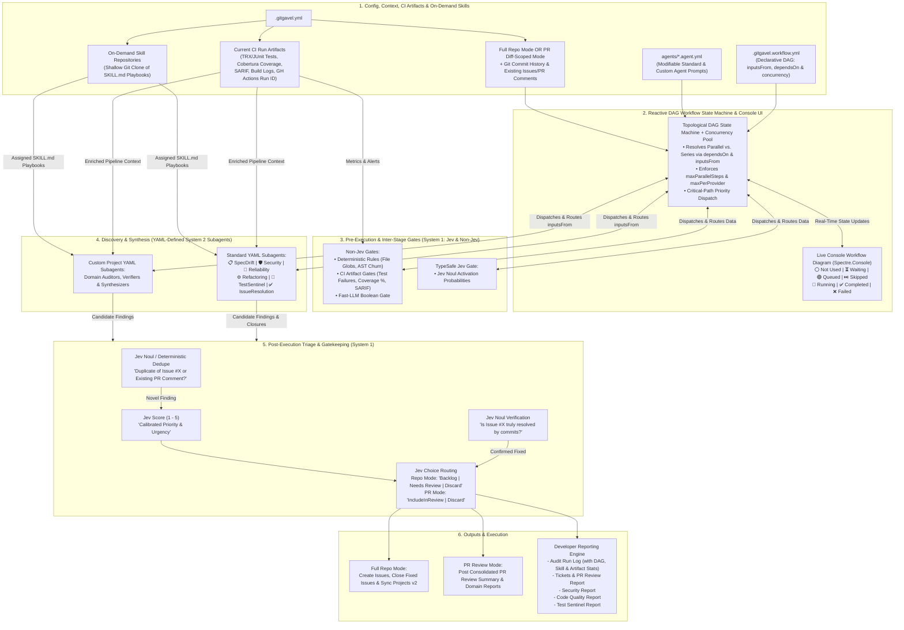

# Technical Specification: Multi-Agent AI Repo Auditor & Backlog Sentinel ("GitGavel")

## 1. Executive Summary

**GitGavel** is an automated repository and pull request audit tool designed to run in continuous integration (CI) or as a standalone CLI. It employs a **configurable, reactive System 1 + System 2 multi-agent architecture** that operates across two execution modes using **declarative YAML-defined agents, workflows, CI run artifacts, and external agent skills**:

* **System 2 (Declarative Generative Subagents)**: Deep reasoning agents (powered by Claude/Gemini/OpenAI) audit across specification alignment (`SpecDriftAgent`), security posture (`SecurityAuditorAgent`), functional reliability & performance (`ReliabilityAgent`), code architecture (`RefactoringAgent`), automated test completeness (`TestSentinelAgent`), open issue completion (`IssueResolutionAgent`), and **custom project-defined YAML agents**.
  * All standard and custom agent prompts, scopes, artifact bindings, and skill assignments live in modifiable YAML files (`agents/*.agent.yml`) rather than hardcoded C# strings.
  * In **Full Repository Audit Mode** (scheduled/manual runs), the subagents audit the full repository scope to maintain the engineering backlog and close completed issues.
  * In **Pull Request Review Mode** (auto-triggered on every PR), the **same subagents** run strictly against the **files and diffs changed in the Pull Request**, generating a consolidated PR review summary and targeted domain reports.
* **System 1 (Pluggable Jev & Non-Jev Gating & Triage Engine)**: A fast decision engine supporting **TypeSafe Jev** (`Noul`, `Score`, `Choice`), **Non-Jev Deterministic & CI Artifact Rule Gates**, and **Fast-LLM Gates**:
  * **Pre-Execution & Inter-Stage Gating**: Evaluates lightweight PR/commit metadata, AST complexity deltas, and current CI run artifacts (SARIF alerts, TRX/JUnit test failures, Cobertura coverage thresholds) via deterministic rules, fast-LLM checks, or Jev `Noul` in <250ms to dynamically activate only relevant subagents and slash LLM token consumption by up to 80%.
  * **Post-Execution Finding & Closure Triage**: Validates candidate findings and issue resolution proofs in milliseconds—performing pairwise duplicate checks against existing issues or existing PR review comments via `Noul` probabilities, verifying completed issues via `Noul`, calibrating urgency scoring via `Score`, and routing findings to **GitHub Projects (v2)** columns (`Backlog`, `AI Triage`, `Done`, `Discard`) or **GitHub Pull Request Reviews** (`IncludeInReview`, `Discard`) via `Choice`.
* **Reactive DAG Workflow State Machine (`.gitgavel.workflow.yml`)**: A dedicated YAML workflow engine that automatically resolves **parallel vs. series execution** from node dependencies (`inputsFrom` for order + data passing vs. `dependsOn` for order-only execution without result passing) across both System 1 and System 2 models, protected by bounded concurrency (`maxParallelSteps`, `maxPerProvider`) and critical-path scheduling.
* **Live Console Workflow & Agent Status Diagram**: Renders the active workflow graph in the terminal using `Spectre.Console`, updating in real time as nodes transition across `⚪ Not Used`, `⏳ Waiting`, `🟢 Queued`, `⏭️ Skipped`, `🔄 Running`, `✅ Completed`, and `❌ Failed`.
* **Current CI Run Artifact & On-Demand Skill Ingestion**: Ingests test results, code coverage, SARIF reports, and build logs from the active CI pipeline run (`$GITHUB_RUN_ID` or workspace globs) and shallow-clones external **Skill Repositories** (`SKILL.md`) on demand to enrich agent context.
* **Developer Reporting Engine**: Emits dedicated, structured reports (Run Log, Tickets & PR Review Report, Security Report, Code Quality Report, Test Sentinel Report) available both locally and as GitHub Action Step Summaries and downloadable CI artifacts.

---

## 2. Core Objectives & Non-Goals

### Objectives
- **Multi-Domain Specialization**: Dedicated subagents for Spec Drift, Security, Reliability & Performance, Architecture/Refactoring, Automated Testing, and Issue Resolution Verification to eliminate prompt dilution across both repository audits and PR reviews.
- **Modifiable YAML Standard & Custom Agents**: Externalize all standard agent prompts, scopes, gates, and skills into declarative YAML files (`agents/*.agent.yml`) alongside user-defined custom agents so teams can tailor prompts and add new agents without recompiling code.
- **Reactive DAG Workflow State Machine & Bounded Concurrency**: Define multi-step System 1 and System 2 pipelines in a dedicated `.gitgavel.workflow.yml` file where parallel vs. series execution is automatically derived from `inputsFrom` (order + data) and `dependsOn` (order-only, no data passed), with global and per-provider concurrency semaphores and critical-path scheduling to prevent LLM rate-limit exhaustion.
- **Live Console Workflow Diagram**: Display a live-updating console diagram showing the structure of all workflow stages, gates, and agents and their real-time states (`Waiting`, `Queued`, `Running`, `Skipped`, `Not Used`, `Completed`, `Failed`).
- **Composable On-Demand Agent Skills**: Point to one or more Git skill repositories or local skill folders in `.gitgavel.yml`, fetch required skills on demand during CI pipeline execution, and map specific skills (`SKILL.md`) to specific agents.
- **Current CI Pipeline Artifact Ingestion**: Automatically ingest artifacts produced earlier in the current CI pipeline run (TRX/JUnit test results, Cobertura/LCOV code coverage, SARIF scans, compiler warnings, or GitHub Actions `$GITHUB_RUN_ID` artifacts) to drive deterministic gates and provide rich runtime context to agents.
- **Unified Agent Pipeline for PR Reviews (Diff-Only Scope)**: Automatically runs on every Pull Request, scoping the `SpecDrift`, `Security`, `Reliability`, `Refactoring`, and `TestSentinel` subagents strictly to the **changes in the PR** (modified files and diff hunks) and posting triaged findings as a consolidated PR review summary and domain reports on the Pull Request (avoiding PR clutter from noisy inline diff comments).
- **Comprehensive Test Pyramid Auditing**: Automated detection of missing unit, integration, and end-to-end (E2E) tests, extra scenario coverage, and test reliability improvements.
- **Automated Completed Issue Closure**: Continuous verification of open GitHub issues against the current codebase and git commit history, automatically closing resolved issues with an explanatory comment detailing how the issue was fixed and referencing the specific commit SHAs.
- **Hybrid Jev & Non-Jev Gating**: Support sub-second deterministic rule gates, CI artifact metric gates, and fast-LLM gates alongside TypeSafe Jev (`Noul`, `Score`, `Choice`) for pre-execution gating, inter-stage filtering, and post-execution triage.
- **Pairwise Deduplication via Jev `Noul`**: Probabilistic duplicate detection against existing issues and existing PR review comments without expensive generative LLM calls.
- **Developer-Centric Reporting**: Comprehensive developer reports for pipeline logs, created/closed tickets, PR review actions, security posture, architectural health, and automated test coverage.
- **Zero-Infra Context Routing**: Avoids external vector databases in favor of deterministic AST, git history, PR diff, CI artifact, and targeted file routing.
- **GitHub Projects (v2) Automation**: Seamless GraphQL automation mapping findings and resolved issues directly to project columns (`Backlog`, `AI Triage`, `Done`, `Discard`).
- **Container-First Distribution**: Packaged as a self-contained, trimmed .NET 10 Alpine container image.

### Non-Goals
- **Autonomous Code Commits**: The tool will not auto-commit code changes or merge pull requests; its boundary is backlog ticket lifecycle management (creating, updating, and closing resolved issues) and Pull Request review commenting.
- **External Vector DB Hosting**: No hosted vector DBs or cold embedding passes in CI; context routing is handled via file patterns, git commit history, PR diffs, CI run artifacts, and AST inspection.

---

## 3. Hybrid System 1 + System 2 Architecture



### 3.1 Reactive DAG Workflow State Machine & Bounded Concurrency

Instead of requiring manual `parallel` vs. `series` stage flags, GitGavel orchestrates both **System 1** (Jev and Non-Jev gates/evaluators) and **System 2** (Generative LLM agents) using a **Dependency-Driven Directed Acyclic Graph (DAG) State Machine** defined in `.gitgavel.workflow.yml`:

1. **Automatic Parallel vs. Series Resolution (`inputsFrom` vs. `dependsOn`)**:
   * **`inputsFrom: ["nodeA", "nodeB"]` (Order + Data Dependency)**: The node waits in series until `nodeA` and `nodeB` complete **and** receives their output results (candidate findings, Jev probabilities/scores, or filtered file scopes) in its input context.
   * **`dependsOn: ["nodeA"]` (Order-Only Dependency — No Results Passed)**: The node waits in series until `nodeA` finishes (e.g., waiting for a pre-gate or waiting for discovery to finish before running `issueResolution`), but **no results are passed** into its input context (`inputsFrom` is empty).
   * **Automatic Parallelism**: Any nodes whose upstream `dependsOn ∪ inputsFrom` dependencies are satisfied automatically transition to `Queued` and execute in **parallel** without artificial stage barriers. If `security` finishes in 4s while `tests` takes 20s, a downstream node that only depends on `security` (`inputsFrom: ["security"]`) unlocks immediately at 4s.
2. **Bounded Concurrency Pool & Provider Rate-Limit Protection**:
   * Running too many System 2 LLM steps simultaneously can trigger HTTP `429 Too Many Requests` / Tokens-Per-Minute (TPM) rate limits and spike memory in CI containers. The state machine separates **`🟢 Queued (Ready)`** from **`🔄 Running`** using a two-tier semaphore pool:
     * **`maxParallelSteps` (Default: `4`)**: Maximum total System 2 agents allowed in the `🔄 Running` state simultaneously (in-memory deterministic System 1 gates execute immediately without consuming LLM concurrency slots).
     * **`maxPerProvider` (e.g. `gemini: 3`, `anthropic: 2`, `openai: 3`)**: Per-provider concurrency limits preventing a burst of ready nodes from saturating a single LLM provider's rate limit.
     * **Critical-Path Priority Dispatch (`schedulingPolicy: "critical-path"`)**: When multiple nodes are in `🟢 Queued` awaiting a concurrency slot, the scheduler dispatches the node with the **most downstream dependents** (longest critical path in the DAG) first so downstream series chains unlock as early as possible.
3. **Node State Machine Lifecycle**:
   ```mermaid
   stateDiagram-v2
       [*] --> NotUsed : enabled == false
       [*] --> Queued : No upstream dependencies (Root node)
       [*] --> Waiting : Has upstream dependsOn / inputsFrom
       Waiting --> Queued : All upstream nodes Completed (and Gates passed)
       Waiting --> Skipped : Upstream Gate rejected OR required upstream Skipped/Failed
       Queued --> Running : Acquired global + provider concurrency slot (Critical-Path Priority)
       Running --> Completed : Execution succeeded (releases concurrency slot)
       Running --> Skipped : Self-Gate / Empty Scope evaluated to Skip (releases slot)
       Running --> Failed : Unhandled exception / Timeout (releases slot)
       Completed --> [*]
       Skipped --> [*]
       Failed --> [*]
       NotUsed --> [*]
   ```
4. **Upfront Topological Validation (`gitgavel validate`)**:
   * At startup, GitGavel validates `.gitgavel.workflow.yml` using Kahn's topological sort algorithm to detect circular dependencies, unknown node/agent IDs, or unreachable branches before spending any LLM tokens.

### 3.2 Live Console Agent & Workflow Status Diagram

During `gitgavel audit`, GitGavel renders a live-updating workflow diagram in the terminal using `Spectre.Console` (`AnsiConsole.Live`). The diagram visualizes the topological levels of the workflow DAG, active concurrency slot usage, data-passing vs. order-only edges, and the real-time status of every System 1 gate and System 2 agent:

* **Status Badges**:
  * `⚪ Not Used`: Agent or node is disabled in configuration (`enabled: false`) or excluded from the active workflow.
  * `⏳ Waiting`: Blocked waiting on one or more upstream nodes in `dependsOn` or `inputsFrom` (explicitly lists which upstream nodes it is waiting on).
  * `🟢 Queued`: All upstream dependencies are satisfied; waiting in the priority queue for an available global/provider concurrency slot.
  * `⏭️ Skipped`: Bypassed by a System 1 Jev gate, a Non-Jev deterministic/artifact gate, or an unsatisfied upstream condition (displays skip reason and probability/rule).
  * `🔄 Running`: Actively executing (displays System 1 engine or System 2 provider/model badge, attached skills/artifacts count, and live elapsed timer).
  * `✅ Completed`: Finished execution (displays duration, token usage, findings/decisions count, and downstream forwarding indicator).
  * `❌ Failed`: Execution failed or timed out (displays error summary).

```text
╭─ GitGavel Workflow State Machine (.gitgavel.workflow.yml) ── [Active Slots: 3/3 gemini] ─╮
│                                                                                          │
│  Level 0 (Root Gate)                                                                     │
│   └── ✅ ⚡ pre-gate (System 1: Det+Jev) ─────────── 0.2s (4 activated, 1 skipped)       │
│                                                                                          │
│  Level 1 (Auto-Parallel — dependsOn: [pre-gate])                                         │
│   ├── ✅ 🛡️ security (System 2: gemini-2.5-pro) ──── 4.9s (2 findings) [critical-path]   │
│   ├── 🔄 📋 specDrift (System 2: gemini-2.5-pro) ─── 5.2s elapsed...   [2 skills]        │
│   ├── 🔄 🐛 reliability (System 2: gemini-3.1-pro) ─ 5.2s elapsed...   [1 skill]         │
│   ├── 🟢 🧪 tests (System 2: gemini-2.5-pro) ─────── Queued (awaiting gemini slot 3/3)   │
│   ├── ⏭️ ⚙️ refactoring (System 2: gemini-2.5-flash) ─ Skipped by [pre-gate] (P=0.18)    │
│   └── ⚪ 🏛️ customApiAudit (System 2) ────────────── Not Used (enabled: false)           │
│                                                                                          │
│  Level 2 (Reactive Series — unlocks per branch as upstream finishes!)                    │
│   ├── ✅ 🔍 security-exploit-gate (System 1: Det) ══► inputsFrom: [security] (Passed)    │
│   │    └── 🔄 🛠️ remediationArchitect (System 2) ══► inputsFrom: [security-exploit-gate] │
│   └── ⏳ ✅ issueResolution (System 2) ───► dependsOn: [specDrift, reliability, tests]   │
│                                                                                          │
│  Level 3 (Final Convergence)                                                             │
│   └── ⏳ ⚖️ post-triage (System 1: Jev) ══► waiting on: [specDrift, reliability, ...]    │
╰──────────────────────────────────────────────────────────────────────────────────────────╯
```

* **CI / Non-Interactive Log Fallback**: When running in non-interactive CI environments (`Console.IsOutputRedirected` or `CI=true`), GitGavel prints the initial workflow topology diagram before execution, logs clean single-line state transitions as nodes complete or skip, and renders the final completed diagram snapshot upon workflow completion to avoid ANSI cursor artifacts in CI logs.

---

## 4. Specialized Subagents & Execution Modes (System 2: Discovery)

All five core domain subagents (`SpecDriftAgent`, `SecurityAuditorAgent`, `ReliabilityAgent`, `RefactoringAgent`, and `TestSentinelAgent`) are shared between **Full Repository Audit Mode** and **Pull Request Review Mode**. When running in **Pull Request Review Mode**, `RepoContext` is filtered strictly to the **files and diff patches modified in the Pull Request**, ensuring the agents only review changes introduced by the PR.

### 4.1 📋 Spec Drift Agent
* **Role**: Detects divergence between written requirements and code implementation.
* **Model Tier**: High Reasoning (Gemini 3.1 Pro Preview / Claude 3.5 Sonnet).
* **Inputs**:
  * *Full Repo Mode*: Spec files (`specs/*.md`, `docs/**/*.md`), OpenAPI schemas, public controllers/interfaces, and DTOs.
  * *PR Review Mode*: Spec files + only the source files and diff hunks modified in the PR.
* **Output**: Candidate findings highlighting missing endpoints, parameter drift, or divergent logic (created as backlog issues in Repo Mode, or included in PR review summaries in PR Mode).

### 4.2 🛡️ Security Auditor Agent
* **Role**: Identifies security vulnerabilities, credential leaks, and authorization flaws.
* **Model Tier**: High Reasoning (Gemini 3.1 Pro Preview / Claude 3.5 Sonnet).
* **Inputs**:
  * *Full Repo Mode*: Auth handlers, database queries, API clients, app configuration, and static security scan reports (SARIF).
  * *PR Review Mode*: Only the changed files and unified diff patches in the PR (+ any SARIF alerts on those changed lines).
* **Output**: Candidate findings citing specific attack vectors, OWASP classifications, and secure remediation code.

### 4.3 ⚙️ Architecture & Refactoring Agent
* **Role**: Flags architectural debt, tight coupling, and maintainability issues.
* **Model Tier**: Fast Reasoning (Gemini 2.5 Flash / GPT-4o-mini).
* **Inputs**:
  * *Full Repo Mode*: Core service classes, domain models, AST complexity hotspots, and dependency injection wiring.
  * *PR Review Mode*: AST complexity and unified diff patches for only the files modified in the PR.
* **Output**: Candidate findings proposing structural refactoring, abstraction, or consolidation of duplicated logic.

### 4.4 🐛 Reliability & Performance Agent (`ReliabilityAgent`)
* **Role**: Audits production code for functional bugs, performance issues, performance improvements, provable logic defects, runtime crash paths, concurrency defects, and resource leaks.
* **Model Tier**: High Reasoning (Gemini 3.1 Pro Preview / Claude 3.5 Sonnet).
* **Core Responsibilities**:
  * **Provable Logic Defects & Bugs**: Detects off-by-one errors, inverted conditions, state overwrite bugs inside loops, broken pagination, silent data truncation, and incorrect edge-case handling.
  * **Crash Paths & Exception Safety**: Flags unhandled exceptions, null/empty dereference risks, unsafe type casts, division-by-zero or index-out-of-range paths, and missing validation at external API or I/O boundaries.
  * **Concurrency & Async Defects**: Identifies race conditions on shared state, deadlocks, synchronous blocking on asynchronous calls (`Task.Result` / `.Wait()`), `async void` methods, unawaited tasks, and missing `CancellationToken` propagation.
  * **Resource Leaks**: Uncovers undisposed `IDisposable` / `IAsyncDisposable` objects (`Stream`, `Process`, `HttpClient`, database connections, file handles, sockets) and unbounded in-memory collections or caches.
  * **Performance Issues & Improvements**: Detects $O(N^2)$ or N+1 API/database loops, redundant allocations or serialization in hot paths, unbounded network/file reads, and actionable performance optimization opportunities.
* **Inputs**:
  * *Full Repo Mode*: Production source files, AST symbol/complexity summaries, service implementations, and I/O or concurrency-heavy modules.
  * *PR Review Mode*: Only the production source files and unified diff patches modified in the PR.
* **Output**: Candidate findings (`Category: "Reliability"`) detailing the root cause, failure mode or performance bottleneck, and a concrete, drop-in remediation code snippet.

### 4.5 🧪 Test Sentinel Agent
* **Role**: Audits automated testing across the entire test pyramid (**Unit**, **Integration**, and **End-to-End / E2E**).
* **Model Tier**: High Reasoning (Gemini 3.1 Pro Preview / Claude 3.5 Sonnet).
* **Core Responsibilities**:
  * **Missing Test Detection**: Identifies critical production classes, public methods, core business rules, and error paths that lack automated tests across unit, integration, and E2E tiers.
  * **Extra Scenarios & Boundary Coverage**: Uncovers omitted edge cases, boundary conditions, invalid inputs, failure modes, concurrency/race hazards, and regression scenarios not currently exercised in existing test suites.
  * **Test Quality & Maintainability**: Flags brittle assertions, tautological mocks, flaky patterns (e.g. arbitrary `Thread.Sleep`), tight coupling to private implementation details, poor test isolation, and test suite code duplication.
  * **Test Pyramid Alignment**: Categorizes findings by testing tier (`Unit`, `Integration`, `E2E`) and verifies appropriate balancing across the pyramid.
* **Inputs**:
  * *Full Repo Mode*: Test files (`tests/**/*.cs`, `**/*.spec.ts`, `**/*.test.ts`, `tests/**/*.py`, `cypress/`, `playwright/`, `e2e/`), production source files, domain models, API routes, and AST complexity hotspots.
  * *PR Review Mode*: Only the production and test files/diffs changed in the PR, verifying that new or modified code in the PR has adequate Unit/Integration/E2E test coverage.
* **Output**: Candidate findings citing untested logic, missing test scenarios, concrete test implementation blueprints with executable code snippets, and targeted test tier classification.

### 4.6 ✅ Issue Resolution & Closure Agent
* **Role**: Audits open GitHub issues against the current repository state and commit history to detect completed work and automatically close resolved issues with a clear audit trail.
* **Model Tier**: Fast / High Reasoning (Gemini 2.5 Flash / Claude 3.5 Sonnet).
* **Core Responsibilities**:
  * **Completion Detection**: Cross-references open GitHub issues (including previously generated `ai-backlog` tickets and human-authored issues) against current source code, tests, and recent git commit history (`git log`).
  * **Commit Attribution**: Identifies the exact commit SHA(s) and commit messages that implemented the fix, refactoring, or test coverage requested by the issue.
  * **Resolution Summary Generation**: Drafts a concise closing comment explaining *how* the issue was resolved in the codebase and listing the specific commit SHA(s) that fixed it.
* **Inputs**: Open GitHub issues (title, body, embedded `gitgavel-metadata`, target file paths), git commit log (`git log`), and current file contents of affected modules.
* **Output**: Candidate issue closure records containing the target Issue `#`, a verification summary of how the fix was implemented, the list of resolving commit SHAs, and confidence evidence for System 1 validation.

### 4.7 🔍 Pull Request Review Execution Mode (Diff-Scoped Multi-Agent Review)
When GitGavel runs in **Pull Request Review Mode** (automatically triggered on `pull_request` events in GitHub Actions or via `--pr <number>`):
1. **Diff-Only Context Scoping**: GitGavel fetches the Pull Request's changed files, unified diff patches (`@@ -a,b +c,d @@`), and existing PR review comments/threads. It scopes `RepoContext.SourceFiles` and `RepoContext.TestFiles` **exclusively to the files modified in the PR**, attaching each file's unified diff patch so the subagents only inspect lines changed in the PR.
2. **Same Subagents, Unified Pipeline**: The exact same enabled System 2 subagents (`SpecDriftAgent`, `SecurityAuditorAgent`, `ReliabilityAgent`, `RefactoringAgent`, `TestSentinelAgent`, plus any enabled custom YAML agents) execute over the PR-scoped context according to the workflow DAG.
3. **Jev Triage & PR Finding Deduplication**: Candidate findings from all subagents are evaluated by Jev (`Noul` deduplication against existing PR review comments and open issues, `Score` priority calibration, and `Choice` routing into `IncludeInReview` or `Discard`).
4. **PR Review & Domain Report Publishing**: Instead of creating standalone backlog issues or scattering noisy inline comments across the diff, GitGavel submits:
   * **Consolidated GitHub Pull Request Review Summary**: A single, clean review summary synthesizing all actionable findings, affected files/lines, and remediation steps without cluttering the PR diff with low-value inline comments.
   * **Dedicated Domain Report Comments**: For every domain where findings are detected in the PR (`Security`, `SpecDrift` / `Reliability` / `Refactoring`, or `Testing`), GitGavel automatically posts that domain's full developer report (`Security Audit Report`, `Code Quality & Spec Report`, or `Test Quality & Coverage Report`) as a dedicated comment on the Pull Request so reviewers can read all findings directly in the PR conversation without digging through CI action artifacts.

### 4.8 🧩 Declarative YAML Standard & Custom Agents (`agents/*.agent.yml`)
To allow every project to tailor agent instructions, file scopes, gates, artifact bindings, and skills without modifying C# source code:
1. **Standard Agent Prompts Extracted to YAML**: All six built-in agents (`specDrift`, `security`, `reliability`, `refactoring`, `tests`, `issueResolution`) have their `systemPrompt`, `userPromptTemplate`, `scope`, default `gate`, `artifacts`, and `skills` definitions moved out of C# classes and into standard `.agent.yml` files (`agents/spec-drift.agent.yml`, `agents/security.agent.yml`, `agents/reliability.agent.yml`, `agents/refactoring.agent.yml`, `agents/test-sentinel.agent.yml`, `agents/issue-resolution.agent.yml`).
2. **Eject & Override Support**: GitGavel ships with embedded default YAML definitions for the six standard agents and allows exporting them into `.gitgavel/agents/` (via `gitgavel init --eject-agents`) or overriding any field per project.
3. **Custom Project-Specific Agents**: Teams can drop additional `*.agent.yml` files into `.gitgavel/agents/` (or pass `--agents <PATH>`) to introduce domain-specific System 2 auditors, synthesizers, or remediation verifiers using the exact same YAML schema as standard agents.
4. **Template Placeholders**: Agent YAML prompt templates support structured context interpolation (`{{RepositorySymbolMap}}`, `{{ScopedFiles}}`, `{{PullRequestDiffs}}`, `{{PipelineArtifacts}}`, `{{UpstreamStageResults}}`, `{{AgentSkills}}`).

### 4.9 🔀 Separate Workflow Configuration (`.gitgavel.workflow.yml`)
Workflows are defined in a dedicated `.gitgavel.workflow.yml` file (configured via `workflowFile` in `.gitgavel.yml` or `--workflow <PATH>` on the CLI):
* **Unified System 1 & System 2 Graph**: Nodes in the workflow can be `system: "system1"` (Deterministic rules, CI artifact gates, Fast-LLM gates, or TypeSafe Jev `Noul` / `Score` / `Choice` steps) or `system: "system2"` (any standard or custom YAML agent).
* **Selective Data Passing (`inputsFrom` vs. `dependsOn`)**:
  * Setting `inputsFrom: ["nodeA"]` waits for `nodeA` to complete and pipes its output (e.g. candidate findings or gating decisions) into the current step.
  * Setting `dependsOn: ["nodeA"]` (with `inputsFrom: []`) enforces execution order (waiting for `nodeA` to complete) **without** passing any results from `nodeA` into the current step's context.
* **Bounded Concurrency**: A top-level `concurrency:` block configures `maxParallelSteps` (default `4`), `maxPerProvider` caps, and `schedulingPolicy: "critical-path"` to prevent rate-limit exhaustion.

### 4.10 📚 On-Demand Multi-Repository Agent Skills (`skills:`)
Agents can be equipped with reusable domain playbooks and engineering standards hosted in one or more external Git repositories or local folders:
1. **Skill Repository Registry**: The top-level `skills.repositories` block in `.gitgavel.yml` maps repository aliases (e.g. `team-skills`, `security-playbooks`, `local`) to Git URLs (with optional `ref` branch/tag/SHA, `path` subdirectory, and `authEnv` token variable) or local paths.
2. **On-Demand Pipeline Fetching**: During `gitgavel audit` execution in CI pipelines, GitGavel inspects the active workflow's enabled agents, determines which skill repositories are referenced, and fetches them **on-demand** using fast shallow clones (`git clone --depth 1 --branch <ref> --single-branch`) into `.gitgavel/cache/skills/<alias>`.
3. **`SKILL.md` Discovery & Prompt Injection**: Each skill (`<skill-name>/SKILL.md` with YAML frontmatter + Markdown instructions, or `<skill-name>.md`) assigned to an agent via `skills: ["team-skills/owasp-dotnet", ...]` is validated via `PathSecurity` and injected into that agent's `### Active Agent Skills & Domain Playbooks` prompt section within a configurable character budget (`maxSkillCharsPerAgent`).

### 4.11 📦 Current CI Run Pipeline Artifact Ingestion (`artifacts:`)
Because GitGavel frequently runs inside an extensive CI/CD pipeline, it can ingest build, test, coverage, and security artifacts produced earlier in the **current pipeline run** to power both System 1 gates and System 2 agent context:
1. **Supported Artifact Formats**:
   * **Test Execution Results (`trx`, `junit`)**: Extracts total/passed/failed/skipped counts, failing test names, failure messages, and stack traces.
   * **Code Coverage Reports (`cobertura`, `lcov`, `opencover`)**: Extracts overall line/branch coverage percentages and per-file/per-method uncovered line ranges.
   * **Static Security & Analyzer Reports (`sarif`)**: Extracts SAST, container, and compiler analyzer alerts (Semgrep, CodeQL, Trivy, Roslyn).
   * **Build & Custom Logs (`text`, `markdown`, `json`)**: Extracts compiler warnings, benchmark diffs, or custom pipeline stage outputs.
2. **Local Workspace & GitHub Actions Run (`$GITHUB_RUN_ID`) Collection**:
   * **Workspace Globs (`paths`)**: Reads artifacts present in the workspace from preceding steps or `actions/download-artifact@v4`.
   * **On-Demand GitHub Run Fetch (`fromCurrentGithubRun: true`)**: Uses `$GITHUB_RUN_ID` and `$GH_TOKEN` to query the GitHub Actions Artifacts API and download named artifacts generated by upstream jobs in the current workflow run.
3. **Gate & Prompt Integration**:
   * **System 1 Gates**: Deterministic and Jev gates can query artifact metrics (e.g., `artifacts.testResults.failedCount > 0`, `artifacts.coverage.lineCoveragePercent < 80`, `artifacts.sarif.alertCount > 0`).
   * **System 2 Agents**: Agents declare `artifacts: ["test-results", "coverage-report"]` in their `.agent.yml` file to receive structured summaries of those artifacts in their prompt context.

---

## 5. System 1 Decision & Gating Engine (Jev & Non-Jev Gates)

System 1 operates across pre-execution gating, inter-stage workflow filtering, and post-execution finding/closure triage. It supports both **TypeSafe Jev** (`jev`) and **Non-Jev Gate Engines** (`deterministic`, `artifact`, and `llm`):

### 5.1 Pre-Execution & Inter-Stage Gating (Jev `Noul` & Non-Jev Gates)
Before launching expensive System 2 subagents (or between series steps in `.gitgavel.workflow.yml`), GitGavel evaluates sub-second System 1 gates to activate only warranted subagents and filter intermediate results.

#### 5.1.1 Non-Jev Powered Gates (`deterministic`, `artifact`, and `llm`)
Workflows and agent definitions can use Non-Jev gates standalone (when running without `JEV_API_KEY` or for strict rule enforcement) or chained before Jev (`engine: "deterministic-then-jev"`):
* **Deterministic Rule & Expression Gates (`engine: "deterministic"`)**: Evaluates zero-latency boolean expressions against repository, PR diff, AST, and upstream workflow state without external API calls:
  * *File & Scope Predicates*: `files.changedCount > 0`, `files.changedMatches('src/Auth/**')`, `files.specFilesChanged > 0`, `git.isPullRequest`.
  * *AST Complexity Predicates*: `ast.maxCyclomaticComplexity >= 15`, `ast.totalComplexityDelta > 10`.
  * *Upstream Workflow Predicates*: `inputs.findingsCount > 0`, `inputs.findingsCount(severity >= 'High') > 0`.
* **CI Run Artifact Metric Gates (`artifacts.*` predicates)**: Evaluates metrics parsed from current CI run artifacts:
  * `artifacts.sarif.alertCount > 0`
  * `artifacts.testResults.failedCount > 0`
  * `artifacts.coverage.lineCoveragePercent < 80`
* **Fast-LLM Gates (`engine: "llm"`)**: Uses a lightweight, low-cost generative model (e.g., `gemini-2.5-flash` or `gpt-4o-mini`) with structured boolean/choice output to evaluate natural-language gating questions when TypeSafe Jev is not configured.

#### 5.1.2 Probabilistic Gating with TypeSafe Jev `Noul` (`engine: "jev"`)
By analyzing lightweight context metadata (<300 tokens) instead of full source files, Jev `SystemOneAsync` determines whether each domain subagent is warranted:
* **Lightweight Input Metadata**:
  * Modified file paths, extensions, and directory boundaries (e.g. `docs/`, `src/Auth/`, `tests/`).
  * PR diff patch statistics (number of additions, deletions, modified files).
  * Specification changes (count of modified specification / OpenAPI documents).
  * AST structural churn (Roslyn cyclomatic complexity deltas, new high-complexity methods).
  * Current CI Run Artifact summaries (SARIF alert counts, test failure counts, coverage percentage).
  * Commit messages and Pull Request title / description.
* **Gating Evaluation with Jev `Noul`** (customizable per agent in `agents/*.agent.yml`):
  * `run_spec_drift`: *"Do the changes modify specifications, API documentation, OpenAPI schemas, or public interface contracts?"*
  * `run_security`: *"Do the changes touch security-critical code, authentication, authorization, cryptography, data access, network boundaries, or third-party dependencies?"*
  * `run_reliability`: *"Do the changes modify or introduce asynchronous execution, concurrency, task scheduling, exception handling, resource disposal, or performance-critical loops?"*
  * `run_refactoring`: *"Do the modified files exhibit significant structural complexity churn, high cyclomatic complexity, or large method modifications?"*
  * `run_tests`: *"Were new production features or branching logic introduced that require automated unit, integration, or E2E test verification?"*
* **Gating Threshold & Subagent Activation**:
  * An enabled subagent is activated if its Jev activation probability $P \ge \text{minConfidence}$ (default: $0.50$).
  * If $P < \text{minConfidence}$, the subagent transitions to `⏭️ Skipped` in the workflow state machine, preventing expensive LLM token consumption and unnecessary API latency.
* **Deterministic Safety Overrides**:
  * **SARIF Alert Override**: If `SarifFindings.Count > 0`, `SecurityAuditorAgent` is **always forced to run**, guaranteeing static scan alerts are triaged by the LLM.
  * **Specification Edit Override**: If `SpecFiles` modified $> 0$, `SpecDriftAgent` is **always forced to run**.
  * **AST Complexity Override**: If any modified method has Roslyn cyclomatic complexity $\ge 15$, `RefactoringAgent` is **always forced to run**.
  * **CLI Override (`--all-agents`)**: Passing `--all-agents` (or `--no-gate`) explicitly bypasses pre-execution triage, forcing all enabled subagents to run unconditionally.
  * **Offline / Mock Fallback**: In offline mock modes (`--mock`, `--mock-llm`) or when `triage.subagentGating.enabled: false`, all enabled subagents execute without gating.

### 5.2 Deduplication with Jev `Noul`
* **Primitive**: `Noul` (Boolean probability $0.0 \dots 1.0$).
* **Queries**:
  * *Issue Deduplication*: `Does candidate finding [Candidate_A] represent the same core problem or refactoring target as existing issue #[Issue_N]?`
  * *PR Finding Deduplication*: `Does candidate PR finding [Finding_A] duplicate an existing review comment or thread on Pull Request #[PR_N]?`
* **Behavior**:
  * $P \ge 0.85$ (`autoBacklogConfidence`): Flagged as duplicate $\rightarrow$ **Skip creation / Suppress from PR summary**.
  * $P < \text{humanReviewConfidence}$ ($0.50\text{–}0.60$): Novel finding $\rightarrow$ **Proceed to scoring**.
  * $\text{humanReviewConfidence} \le P < 0.85$: Uncertain $\rightarrow$ Suppress if `P3`; for `P0`–`P2`, add reference to existing issue and route to human review.

### 5.3 Issue Resolution Verification with Jev `Noul`
* **Primitive**: `Noul` (Boolean probability $0.0 \dots 1.0$).
* **Query**: `Does the audit resolution verification confirm that the issue has been fixed in the codebase by the cited commits and fix explanation?`
* **Behavior**:
  * $P \ge 0.90$: Confirmed resolved $\rightarrow$ **Post closing summary comment with commit references, close issue as `completed`, and move project card to `Done`**.
  * $0.60 \le P < 0.90$: Partially resolved or uncertain $\rightarrow$ **Post progress comment referencing the commits without closing the issue**.
  * $P < 0.60$: Not resolved $\rightarrow$ **Leave issue open (no action)**.

### 5.4 Calibrated Priority Scoring with Jev `Score`
* **Primitive**: `Score` (Scale 1 to 5).
* **Criteria**: Evaluates real-world blast radius, maintainability impact, and business urgency for both backlog issues and PR review findings.
* **Mapping**:
  * Score 5: **P0 (Critical)** — Immediate action required (e.g. active security risk; blocks PR merge).
  * Score 4: **P1 (High)** — High priority bug or severe spec divergence.
  * Score 3: **P2 (Medium)** — Standard refactoring or backlog improvement.
  * Score 1–2: **P3 / Low** — Minor suggestion or nit.

### 5.5 Automated Routing with Jev `Choice`
* **Primitive**: `Choice`
  * *Backlog & Issue Lifecycle*: `["Backlog", "NeedsHumanReview", "CloseResolved", "Discard"]`
  * *PR Review Actions*: `["IncludeInReview", "Discard"]`
* **Routing Logic**:
  * **`Backlog`**: Finding is novel, high-confidence, and meets the severity threshold. Issue created and assigned to the project backlog.
  * **`NeedsHumanReview`**: Finding is borderline or potential duplicate. Issue created with `needs-maintainer-review` label and placed in the project `AI Triage` column.
  * **`CloseResolved`**: Open issue is verified as fixed ($P \ge 0.90$). Issue is commented on with the fix explanation and commit SHAs, closed as completed, and moved to the `Done` column in GitHub Projects v2.
  * **`IncludeInReview`**: High-signal PR review finding is consolidated into the top-level PR review summary comment and domain reports.
  * **`Discard`**: Finding is low-value, subjective, or probable hallucination. Silently suppressed.

---

## 6. Developer Reporting Engine

GitGavel generates five distinct reports at the end of each run, saving them to an output directory (default: `./reports/`) and outputting a summary directly into `$GITHUB_STEP_SUMMARY`.

```
reports/
├── 1_audit-run.md            <-- Execution log, timings, tokens, triage & PR/closure stats
├── 2_tickets-report.md       <-- Issues created, updated, closed, skipped, and PR reviews (table format)
├── 2_tickets-report.json     <-- Structured JSON for programmatic parsing
├── 3_security-report.md      <-- Deep vulnerability breakdown & OWASP mapping
├── 4_code-quality-report.md  <-- Spec drift, complexity hotspots, refactoring
└── 5_test-quality-report.md  <-- Missing tests, extra scenarios, and test quality improvements
```

### 6.1 Report 1: Audit Run Log (`1_audit-run.md`)
Designed for maintainers to see exactly what the auditor did during execution:
* **Execution Metrics**: Start time, duration, git commit SHA, branch, active PR number (if run in PR context), and active workflow file path (`.gitgavel.workflow.yml`).
* **Scope Scanned**: Total files indexed, spec files parsed, test files discovered, commits analyzed, PR review threads audited, lines of code evaluated.
* **Workflow State Machine & Agent Diagnostics**: Topological DAG execution trace, final node states (`Completed`, `Skipped`, `NotUsed`, `Failed`), concurrency pool statistics, LLM token consumption (input/output), and API latency per subagent.
* **Loaded Agent Skills & CI Run Artifacts**: Fetched skill repositories (alias, URL/path, resolved commit SHA), skills injected per agent, and ingested current CI run artifacts (TRX/JUnit test summary, Cobertura coverage %, SARIF alert counts, build logs).
* **Jev & Non-Jev Pre-Execution Gating Diagnostics**: Subagents and gates evaluated, activated vs. skipped breakdown, deterministic rule matches, Jev `Noul` activation probabilities, safety overrides triggered, and estimated LLM tokens saved.
* **Jev Post-Execution Triage Statistics**: Total findings evaluated, accepted count, duplicate rejections, borderline issues routed to human triage, issues verified & closed, PR review findings summarized, suppressed noise count.

### 6.2 Report 2: Tickets & PR Review Report (`2_tickets-report.md` & `.json`)
A comprehensive status ledger of all actions taken against GitHub Issues and Pull Requests:
* **Created Issues Table**: Issue #, title, category, Jev urgency score, target project column link.
* **Closed Issues Table**: Issue #, title, resolution summary, fixing commit SHA(s), Jev resolution confidence ($P$), and closure timestamp.
* **Updated Issues Table**: Existing issues appended with new findings or partial fix notes.
* **PR Review Actions Table**: PR #, review verdict, summarized findings (category, file & line), existing review threads audited/resolved, and suppressed duplicate comments.
* **Skipped / Duplicate Findings**: Findings suppressed by Jev `Noul` with references to the existing open issues or PR threads they matched.

### 6.3 Report 3: Security Report (`3_security-report.md`)
A dedicated security briefing for tech leads and security teams:
* **Executive Summary**: Security posture breakdown (Critical / High / Medium count).
* **Vulnerability Findings**:
  * CVE / OWASP classification (e.g. A01: Broken Access Control).
  * Affected file path and line numbers.
  * Attack / exploit vector explanation.
  * Verified remediation code snippet.
  * Correlation with any static scanner SARIF reports (e.g., Semgrep / Trivy).

### 6.4 Report 4: Code Quality & Spec Report (`4_code-quality-report.md`)
A focused maintainability, reliability, and architectural assessment:
* **Spec Drift Analysis**: Discrepancies between requirements docs/OpenAPI and code implementation.
* **Reliability, Bugs & Performance**: Provable logic defects, crash paths, concurrency hazards, resource leaks, and performance bottlenecks/improvements identified by `ReliabilityAgent`.
* **Architectural Hotspots**: High cyclomatic/cognitive complexity classes, domain leaks.
* **Refactoring Catalog**: Proposed design pattern improvements and code de-duplication plans.

### 6.5 Report 5: Test Quality & Coverage Report (`5_test-quality-report.md`)
A dedicated assessment of the automated test suite across Unit, Integration, and E2E tiers:
* **Test Pyramid Health**: Balance overview across Unit, Integration, and E2E tiers with identified blind spots.
* **Missing Tests Catalog**: Uncovered production classes, public APIs, and complex branch paths lacking automated verification.
* **Extra Scenario Blueprint**: Concrete edge cases, boundary parameters, negative assertions, and concurrency scenarios recommended for existing suites.
* **Test Suite Quality & Flakiness**: Brittle assertion warnings, over-mocking anti-patterns, non-deterministic sleeps, and fixture isolation issues.

---

## 7. Issue, Resolution & PR Comment Formatting

### 7.1 New Issue Formatting & Metadata Signature
Every issue created embeds structured metadata in an HTML comment for deterministic parsing, accompanied by curated research and learning references (official framework documentation, Stack Overflow discussions, and architectural articles) to accelerate developer remediation:

```markdown
## ⚠️ Summary
[Concise description of the problem]

## 📍 Details
- **File**: `SolarDiaryTeslaUploader/Services/UploaderService.cs` (lines 45-88)
- **Category**: Security
- **Severity**: High
- **Jev Urgency Score**: 4 / 5
- **Triage Confidence**: 92%

## 💡 Suggested Remediation
[Actionable recommendation and proposed code snippet]

## 📚 Learning & Research References
- [OWASP Top 10 - Cryptographic Failures](https://owasp.org/Top10/A02_2021-Cryptographic_Failures/)
- [Microsoft Learn: Safe Storage of App Secrets](https://learn.microsoft.com/en-us/aspnet/core/security/app-secrets)
- [Stack Overflow: Storing API secrets securely in .NET](https://stackoverflow.com/questions/tagged/asp.net-core-security)

---
<!-- gitgavel-metadata
fingerprint: a9f8e4b2d1c765...
category: Security
jev_score: 4
jev_confidence: 0.92
agent: SecurityAuditor
created_at: 2026-10-13T15:00:00Z
-->
```

### 7.2 Automated Issue Closure Comment Format
When an open issue is verified as completed by the Issue Resolution Agent and Jev `Noul` ($P \ge 0.90$), GitGavel posts a structured explanation comment before closing the issue as `completed`:

```markdown
## ✅ Issue Resolved

GitGavel verified that this issue has been completed in the codebase and is automatically closing it.

### 🛠️ How It Was Fixed
[Concise explanation of the code changes, architectural update, or tests added that resolved the issue]

### 🔗 Resolving Commits
- `cfad09a` — *fix(tests): isolate CI environment variables in GitService fallback test*
- `ebddfb3` — *ci: support both GEMINI_API_KEY and AI_API_KEY secrets in audit workflow*

---
<!-- gitgavel-resolution
resolved_by_commits: ["cfad09afc6f436fb3af957ff2d94eba2d3e1ea36", "ebddfb3f70be02a6ec8e489155c96f78071104a3"]
jev_resolution_confidence: 0.96
agent: IssueResolutionAuditor
closed_at: 2026-10-20T14:15:00Z
-->
```

### 7.3 Pull Request Review & Comment Format
When auditing a Pull Request, GitGavel publishes a single consolidated PR review summary comment (avoiding diff clutter from noisy inline comments) along with dedicated domain reports for affected categories:

```markdown
## ⚖️ GitGavel Pull Request Audit Summary

| Domain | Findings | Prior Threads Resolved |
| :--- | :---: | :---: |
| 🛡️ Security | 0 | 1 / 1 |
| 📋 Spec Alignment | 1 | — |
| ⚙️ Architecture | 0 | — |
| 🧪 Test Coverage | 1 | 2 / 2 |

### 🔍 Key Observations & Action Items
- **Resolved Review Threads**: Confirmed that previous review feedback on `GitService.cs` (env var isolation) was addressed in commit `cfad09a`.
- **Open Action Items**:
  - `Spec Alignment`: Divergence in configuration schema between `SPECIFICATION.md` and `Settings.cs`.
  - `Test Coverage`: Missing boundary scenario tests for token expiry handling in `AuthServiceTests.cs`.

---
<!-- gitgavel-pr-review
pr_number: 42
head_sha: cfad09afc6f436fb3af957ff2d94eba2d3e1ea36
findings_summarized: 2
agent: PrReviewAuditor
reviewed_at: 2026-10-20T14:15:00Z
-->
```

---

## 8. Configuration Schemas (`.gitgavel.yml`, `.gitgavel.workflow.yml`, and `agents/*.agent.yml`)

### 8.1 Main Configuration Schema (`.gitgavel.yml`)

```yaml
version: 1

# Optional path to separate DAG workflow definition file (or override via --workflow <PATH>)
workflowFile: ".gitgavel.workflow.yml"

# Live Console Workflow & Agent Status Diagram
console:
  diagram: true                       # Render topological workflow & agent state diagram in terminal
  liveUpdates: true                   # Live Spectre.Console updates (auto-falls back in non-interactive CI)

# Scope of files to audit
scope:
  specs:
    include: ["SPECIFICATION.md", "README.md", "Dockerfile", "action.yml", "docs/**/*.md", "specs/**/*.md", "api/openapi.json"]
  source:
    include: ["**/*.cs", "**/*.ts", "**/*.py"]
    exclude: ["**/bin/**", "**/obj/**", "**/.git/**"]
  tests:
    include: ["**/*.Tests/**", "tests/**", "**/*.spec.*", "**/*.test.*", "e2e/**"]

# Current CI Pipeline Run Artifact Ingestion
artifacts:
  fromCurrentGithubRun: true          # Fetch named artifacts from active $GITHUB_RUN_ID via GitHub API if not on disk
  maxArtifactContextChars: 12000      # Cap injected artifact summary characters per agent prompt
  sources:
    - id: "test-results"
      type: "trx"                     # options: "trx" | "junit" | "cobertura" | "lcov" | "sarif" | "json" | "text"
      paths: ["TestResults/**/*.trx", "artifacts/test-results/**/*.xml"]
      githubArtifactName: "test-results-artifact"
    - id: "coverage-report"
      type: "cobertura"
      paths: ["TestResults/**/coverage.cobertura.xml"]
      githubArtifactName: "coverage-artifact"
    - id: "semgrep-sarif"
      type: "sarif"
      paths: ["reports/semgrep.sarif"]
      githubArtifactName: "sarif-report"
    - id: "build-warnings"
      type: "text"
      paths: ["artifacts/build-warnings.log"]

# On-Demand Multi-Repository Agent Skills
skills:
  cacheDir: ".gitgavel/cache/skills"
  fetchOnDemand: true                 # Shallow-clone referenced skill repos on-demand during pipeline run
  maxSkillCharsPerAgent: 16000
  repositories:
    - alias: "team-skills"
      git: "https://github.com/my-org/engineering-skills.git"
      ref: "main"
      path: "skills"
      authEnv: "GH_TOKEN"             # Optional token env var for private skill repositories
    - alias: "local"
      localPath: "./.gitgavel/skills"

# System 2 Subagents (Generative LLMs)
# Supported providers: "gemini" | "openai" | "anthropic" | "mock".
# If a subagent switches provider to "openai" or "anthropic" while leaving model at a default "gemini-*" value (or empty),
# the provider automatically falls back to its default model ("gpt-4o" for OpenAI, "claude-3-5-sonnet-20241022" for Anthropic).
subagents:
  definitionsPath: "./.gitgavel/agents" # Directory containing modifiable *.agent.yml files for standard & custom agents
  timeoutSeconds: 300                 # Subagent LLM request timeout (default: 300s / 5 mins)
  specDrift:
    enabled: true
    provider: "gemini"
    model: "gemini-2.5-pro"
    skills: ["team-skills/openapi-governance", "local/adr-compliance"]
  security:
    enabled: true
    provider: "gemini"
    model: "gemini-2.5-pro"
    sarifReports: ["reports/semgrep.sarif"]
    artifacts: ["semgrep-sarif"]
    skills: ["team-skills/owasp-dotnet", "team-skills/github-actions-hardening"]
  reliability:
    enabled: true
    provider: "gemini"
    model: "gemini-3.1-pro-preview"
    artifacts: ["build-warnings"]
    skills: ["team-skills/dotnet-async-concurrency"]
  refactoring:
    enabled: true
    provider: "gemini"
    model: "gemini-2.5-flash"
  tests:
    enabled: true
    provider: "gemini"
    model: "gemini-2.5-pro"
    tiers: ["unit", "integration", "e2e"]
    artifacts: ["test-results", "coverage-report"]
    skills: ["team-skills/xunit-fluentassertions"]
  issueResolution:
    enabled: true
    provider: "gemini"
    model: "gemini-2.5-flash"
    autoCloseCompleted: true          # Automatically close issues verified as fixed
    commitLookbackCount: 50           # Number of recent git commits to inspect for fixes
    includeCommitLinks: true          # Cite resolving commit SHAs & explanation in closing comment

# System 1 Triage Gatekeeper & Pre-Execution Router (Jev & Non-Jev Gates)
triage:
  engine: "jev" # options: "jev" | "deterministic" | "llm-synthesizer"
  subagentGating:
    enabled: true                     # Pre-screen subagents with System 1 gates to reduce token usage
    engine: "deterministic-then-jev"  # options: "jev" | "deterministic" | "llm" | "deterministic-then-jev"
    minConfidence: 0.50               # Minimum Jev Noul probability to activate subagent (default: 0.50)
    alwaysRunSecurityOnSarifAlerts: true # Hard safety fallback: force SecurityAuditor if SARIF findings exist
    alwaysRunSpecDriftOnSpecChanges: true # Hard safety fallback: force SpecDrift if specs modified
    bypassInFullRepoMode: false       # Whether to bypass gating in Full Repo mode (default: false)
  jev:
    apiKeyEnv: "JEV_API_KEY"
    thresholds:
      autoBacklogConfidence: 0.85     # > 0.85 -> Backlog
      humanReviewConfidence: 0.50     # 0.50 - 0.85 -> AI Triage
      autoCloseIssueConfidence: 0.90  # >= 0.90 -> Verify fix, post commit summary & close issue
    dedupeWithNoul: true
  maxIssuesPerRun: 4                  # Safety cap per audit run for P3 issues (P0, P1, and P2 exempt)

# Developer Reporting Engine
reporting:
  outputDir: "./reports"
  githubStepSummary: true             # Writes overview directly to GitHub Actions UI
  formats: ["markdown", "json"]
  reports:
    auditRun: true
    tickets: true
    security: true
    codeQuality: true
    testQuality: true

# GitHub Projects (v2), Issues & PR Review Integration
github:
  labels:
    - "ai-backlog"
  pullRequests:
    enabled: true
    onlyChangedFiles: true            # Scope subagents strictly to files & diffs changed in the PR
    auditExistingReviews: true        # Deduplicate against existing PR review threads & comments
    postSummaryComment: true          # Post consolidated PR review summary comment (avoids inline diff clutter)
    defaultReviewEvent: "COMMENT"     # options: "COMMENT" | "REQUEST_CHANGES" | "APPROVE"
  issueClosure:
    enabled: true
    stateReason: "completed"
  projectsV2:
    enabled: true
    projectNumber: 2
    columns:
      backlog: "Backlog"
      humanReview: "AI Triage"
      done: "Done"                    # Target column when issues are auto-closed as completed
      discard: "Discarded"
    fields:
      priority: "Priority" # Maps Jev Score (1-5) to Project Priority
```

### 8.2 Separate Workflow Schema (`.gitgavel.workflow.yml`)

```yaml
version: 1
name: "Reactive DAG State Machine Audit Workflow"

# Bounded Concurrency & Provider Rate-Limit Protection
concurrency:
  maxParallelSteps: 4                 # Maximum System 2 agents running concurrently
  schedulingPolicy: "critical-path"   # Dispatch nodes with downstream dependents first
  maxPerProvider:
    gemini: 3
    anthropic: 2
    openai: 3

# Declarative DAG Nodes (Parallel vs. Series resolved automatically from dependsOn & inputsFrom)
nodes:
  # 1. Root Gate (System 1: Non-Jev Deterministic & Artifact Rules + Jev Noul)
  - id: "pre-gate"
    name: "Deterministic & Jev Pre-Execution Gate"
    system: "system1"
    engine: "deterministic-then-jev"
    rules:
      forceActivate:
        security: "artifacts.sarif.alertCount > 0 || files.changedMatches('**/Auth/**')"
        tests: "artifacts.testResults.failedCount > 0 || artifacts.coverage.lineCoveragePercent < 80"
        specDrift: "files.specFilesChanged > 0"
      skipIf:
        refactoring: "files.sourceFilesChanged == 0 && ast.maxComplexity < 10"
    jev:
      primitive: "noul"
      minConfidence: 0.50

  # 2. Primary Discovery (All depend only on 'pre-gate' -> Run in PARALLEL up to maxParallelSteps)
  - id: "security"
    agent: "security"
    system: "system2"
    dependsOn: ["pre-gate"]           # Order-only: waits for pre-gate; runs on RepoContext + artifacts

  - id: "specDrift"
    agent: "specDrift"
    system: "system2"
    dependsOn: ["pre-gate"]

  - id: "reliability"
    agent: "reliability"
    system: "system2"
    dependsOn: ["pre-gate"]

  - id: "tests"
    agent: "tests"
    system: "system2"
    dependsOn: ["pre-gate"]

  - id: "refactoring"
    agent: "refactoring"
    system: "system2"
    dependsOn: ["pre-gate"]

  # 3. Reactive Series Chain (Unlocks immediately when 'security' completes, passing its findings forward)
  - id: "security-exploit-gate"
    name: "High-Severity Security Filter (Non-Jev Gate)"
    system: "system1"
    engine: "deterministic"
    inputsFrom: ["security"]          # Order + Data: waits for 'security' AND receives its findings
    condition: "inputs.findingsCount(severity >= 'High') > 0"

  - id: "remediationArchitect"
    agent: "remediationArchitect"
    system: "system2"
    inputsFrom: ["security-exploit-gate"] # Runs in SERIES after gate passes, receiving filtered findings

  # 4. Independent Series Step (dependsOn enforces order, but inputsFrom: [] passes NO results)
  - id: "issueResolution"
    agent: "issueResolution"
    system: "system2"
    dependsOn: ["specDrift", "security", "reliability", "tests"]
    inputsFrom: []                    # Runs independently against git log + open GitHub issues

  # 5. Final System 1 Convergence & Triage
  - id: "post-triage"
    name: "System 1 Deduplication, Scoring & Routing"
    system: "system1"
    engine: "jev"                     # options: "jev" | "llm" | "deterministic"
    type: "finding-and-closure-triage"
    inputsFrom:
      - "specDrift"
      - "security"
      - "remediationArchitect"
      - "reliability"
      - "refactoring"
      - "tests"
      - "issueResolution"
```

### 8.3 Declarative Agent Schema (`agents/*.agent.yml`)

Both standard built-in agents (ejected/overridden in `.gitgavel/agents/`) and custom project agents share the same YAML schema:

```yaml
# .gitgavel/agents/test-sentinel.agent.yml
version: 1
id: "tests"
name: "TestSentinelAgent"
category: "Testing"
enabled: true
provider: "gemini"
model: "gemini-2.5-pro"
timeoutSeconds: 300

# Scope filters specific to this agent
scope:
  include: ["src/**/*.cs", "tests/**/*.cs"]
  exclude: ["**/Migrations/**"]
  includeSpecs: false
  includeTests: true
  includeAst: true

# Current CI run artifacts injected into this agent's context
artifacts:
  - "test-results"
  - "coverage-report"

# Skills injected from on-demand skill repositories
skills:
  - "team-skills/xunit-fluentassertions"
  - "team-skills/playwright-e2e-patterns"

# Default pre-execution gate for this agent (used by pre-gate)
gate:
  engine: "deterministic-then-jev"
  deterministic:
    anyOf:
      - "artifacts.testResults.failedCount > 0"
      - "artifacts.coverage.lineCoveragePercent < 80"
      - "files.changedMatches('src/**/*.cs')"
  jev:
    primitive: "noul"
    question: "Were new production features, bug fixes, or branching logic introduced that require automated test verification?"
    minConfidence: 0.50

systemPrompt: |
  You are the Test Sentinel Agent, an expert software quality and test architect auditing across Unit, Integration, and E2E tiers.
  Analyze the scoped production files, test files, CI test execution results, and code coverage reports.
  Return a JSON array of high-impact testing gaps and concrete test implementation blueprints.

userPromptTemplate: |
  {{PullRequestGuidance}}
  {{AgentSkills}}
  {{PipelineArtifacts}}
  {{UpstreamStageResults}}
  {{RepositorySymbolMap}}
  {{ScopedFiles}}
```

---

## 9. Packaging & GitHub Actions Deployment

### 9.1 Multi-Stage Dockerfile (Alpine + .NET 10)
The container configures `git config --global --add safe.directory '*'` during image build (and passes `-c safe.directory=*` per git invocation) so GitGavel can safely inspect bind-mounted GitHub Actions workspaces owned by external host UIDs without triggering `dubious ownership` errors.

```dockerfile
# Build stage
FROM mcr.microsoft.com/dotnet/sdk:10.0-alpine AS build
WORKDIR /src
COPY . .
RUN dotnet publish src/GitGavel/GitGavel.csproj \
    -c Release \
    -r linux-musl-x64 \
    --self-contained true \
    -p:PublishSingleFile=true \
    -o /app/publish

# Runtime stage
FROM alpine:3.20
RUN apk add --no-cache \
    git \
    ca-certificates \
    libgcc \
    libstdc++ \
    icu-libs \
    libssl3 \
    zlib
WORKDIR /app
COPY --from=build /app/publish/GitGavel /usr/local/bin/gitgavel
RUN chmod +x /usr/local/bin/gitgavel && \
    git config --global --add safe.directory '*'

ENTRYPOINT ["gitgavel"]
```

### 9.2 GitHub Action Workflow with Reports Upload (`action.yml`)
`action.yml` passes `--config` and `--dir` via container `args`, while all optional action inputs (`repository`, `pr_number`, `dry_run`, `mock`, `mock_llm`, `allow_external_paths`, `all_agents`) are automatically bound via GitHub Actions `INPUT_*` environment variables inside `AuditCommand`.

```yaml
name: "GitGavel AI Repo & PR Audit"
on:
  push:
    branches: [main]
  schedule:
    - cron: '0 3 * * 1'
  pull_request:
    types: [opened, synchronize, reopened]
  pull_request_review:
    types: [submitted]
  workflow_dispatch:

permissions:
  issues: write
  pull-requests: write
  contents: read
  repository-projects: write

jobs:
  audit:
    runs-on: ubuntu-latest
    steps:
      - uses: actions/checkout@v4
        with:
          fetch-depth: 0 # Full history enabled for commit-to-issue resolution tracking

      - name: Run GitGavel
        uses: docker://ghcr.io/tyronebramwell/gitgavel:latest
        with:
          config_path: .gitgavel.yml
        env:
          GH_TOKEN: ${{ secrets.GH_TOKEN }}
          GEMINI_API_KEY: ${{ secrets.GEMINI_API_KEY || secrets.AI_API_KEY }}
          AI_API_KEY: ${{ secrets.AI_API_KEY || secrets.GEMINI_API_KEY }}
          JEV_API_KEY: ${{ secrets.JEV_API_KEY }}

      # Upload all five reports as downloadable workflow artifacts
      - name: Upload Audit Reports
        uses: actions/upload-artifact@v4
        if: always()
        with:
          name: gitgavel-audit-reports
          path: ./reports/
          retention-days: 30
```

---

## 10. Implementation Roadmap

| Phase | Milestone | Deliverables |
| :--- | :--- | :--- |
| **Phase 1** | **System 2 Generative Subagents** | - .NET 10 CLI (`gitgavel audit`) with `Spectre.Console`<br>- Targeted file/AST routing (no vector DB required)<br>- Parallel `Task.WhenAll` subagent execution<br>- Specialized prompts for Spec, Security, and Refactoring agents |
| **Phase 2** | **System 1 Jev Triage Engine** | - TypeSafe Jev client integration (`Noul`, `Score`, `Choice`)<br>- Pairwise deduplication with existing GitHub issues<br>- Calibrated routing logic (Backlog vs. AI Triage vs. Discard) |
| **Phase 3** | **Developer Reporting Engine** | - Output generators for developer reports (`audit-run`, `tickets-report`, `security-report`, `code-quality-report`)<br>- Markdown and structured JSON export<br>- `$GITHUB_STEP_SUMMARY` integration |
| **Phase 4** | **GitHub Projects v2 & Packaging** | - Octokit REST client & GraphQL client for Projects v2<br>- Multi-stage Docker image published to GHCR (`ghcr.io/.../gitgavel`)<br>- GitHub Action `action.yml` wrapper and artifact upload workflow |
| **Phase 5** | **Test Sentinel Subagent** | - Test Sentinel Agent auditing Unit, Integration, and E2E test suites<br>- Detection of untested business logic, missing edge cases, and flakiness<br>- Report 5 (`5_test-quality-report.md`) generation<br>- Automated triage and GitHub backlog sync for test gaps |
| **Phase 6** | **Diff-Scoped PR Review Mode** | - Auto-trigger on all Pull Requests (`pull_request` workflow event)<br>- Scope `RepoContext` strictly to files & diff patches changed in the PR<br>- Execute the same System 2 subagents (`SpecDrift`, `Security`, `Reliability`, `Refactoring`, `TestSentinel`) on PR changes<br>- Jev `Noul` deduplication against existing PR review comments & consolidated PR review summary publishing |
| **Phase 7** | **Automated Issue Resolution & Closure** | - Issue Resolution Agent matching open GitHub issues against codebase state and `git log` history<br>- Jev `Noul` high-confidence completion verification ($P \ge 0.90$)<br>- Automated closing comment explaining how the issue was fixed with resolving commit SHAs, closing the issue as `completed`, and moving Projects v2 status to `Done` |
| **Phase 8** | **Reliability & Performance Subagent** | - `ReliabilityAgent` auditing for functional bugs, provable logic defects, crash paths, concurrency hazards, resource leaks, and performance issues/improvements<br>- Integration into full-repo backlog triage, diff-scoped PR reviews, and `4_code-quality-report.md` |
| **Phase 9** | **Jev-Powered Subagent Pre-Execution Triage & Gating** | - `ISubagentTriageRouter` & `JevSubagentTriageRouter` evaluating PR/commit metadata via Jev `Noul`<br>- Deterministic safety overrides (SARIF alerts, spec edits, complexity churn, `--all-agents` CLI flag)<br>- Pre-dispatch gating in `SubagentOrchestrator` to skip irrelevant subagents and reduce token usage by up to 80%<br>- Configuration schema (`triage.subagentGating`) in `GitGavelConfig`<br>- Audit run reporting of skipped agents, gating probabilities, and token savings in `1_audit-run.md`<br>- Unit tests verifying gating logic, fallbacks, and deterministic overrides |
| **Phase 10** | **Live Console Workflow & Agent Status Diagram** | - Real-time `Spectre.Console` DAG & topological stage visualization (`AnsiConsole.Live`)<br>- Live state transitions across `⚪ Not Used`, `⏳ Waiting` (with blocking dependencies), `🟢 Queued` (awaiting concurrency slot), `⏭️ Skipped`, `🔄 Running`, `✅ Completed`, and `❌ Failed`<br>- Clean non-interactive CI log fallback (`Console.IsOutputRedirected` / `CI=true`) |
| **Phase 11** | **Declarative YAML Standard & Custom Agents** | - Extract standard agent prompts (`SpecDrift`, `Security`, `Reliability`, `Refactoring`, `TestSentinel`, `IssueResolution`) out of C# classes into modifiable `agents/*.agent.yml` files<br>- Support `gitgavel init --eject-agents` and custom project `.agent.yml` definitions (`--agents <PATH>` / `subagents.definitionsPath`)<br>- Unified prompt template interpolation (`{{AgentSkills}}`, `{{PipelineArtifacts}}`, `{{UpstreamStageResults}}`) |
| **Phase 12** | **Reactive DAG Workflow State Machine, Concurrency & Non-Jev Gates** | - Dedicated `.gitgavel.workflow.yml` schema (`--workflow <PATH>`) orchestrating System 1 and System 2 nodes<br>- Dependency-driven DAG state machine resolving parallel vs. series execution from `inputsFrom` (order + data) and `dependsOn` (order-only, no results passed)<br>- Bounded concurrency pool (`maxParallelSteps`, `maxPerProvider`, `critical-path` priority dispatch) & topological cycle validation (`gitgavel validate`)<br>- Pluggable Non-Jev gates (`deterministic` rule expressions, CI artifact metric gates, and `llm` fast-model gates) |
| **Phase 13** | **Current CI Run Pipeline Artifact Ingestion** | - Ingest test results (`trx`, `junit`), code coverage (`cobertura`, `lcov`), static scans (`sarif`), and build logs from workspace globs or active `$GITHUB_RUN_ID` GitHub Actions artifacts<br>- Expose parsed artifact metrics to System 1 deterministic/Jev gates and inject structured artifact context into System 2 agent prompts |
| **Phase 14** | **On-Demand Multi-Repository Agent Skills** | - Top-level `skills:` repository registry supporting Git URLs (`ref`, `path`, `authEnv`) and local paths<br>- On-demand shallow git cloning (`git clone --depth 1`) during CI pipeline execution into `.gitgavel/cache/skills/`<br>- Per-agent `SKILL.md` resolution, `PathSecurity` validation, and prompt injection |
