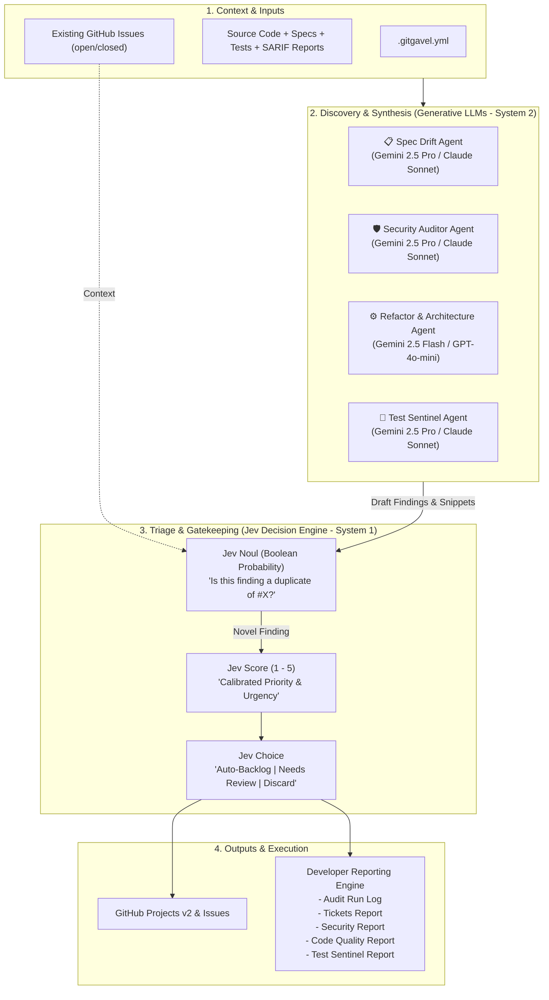

# Technical Specification: Multi-Agent AI Repo Auditor & Backlog Sentinel ("GitGavel")

## 1. Executive Summary

**GitGavel** is an automated repository audit tool designed to run in continuous integration (CI) or as a standalone CLI. It employs a **hybrid System 1 + System 2 multi-agent architecture**:

* **System 2 (Generative Subagents)**: Deep reasoning agents (powered by Claude/Gemini/OpenAI) audit the repository across specification alignment, security posture, code architecture, and automated test completeness (Unit, Integration, E2E), generating structured remediation plans.
* **System 1 (Jev Decision Engine)**: A fast, probabilistic decision engine (powered by TypeSafe Jev) validates candidate findings in milliseconds, performing pairwise duplicate checks via `Noul` probabilities, calibrated urgency scoring via `Score`, and triaging tickets into appropriate **GitHub Projects (v2)** columns via `Choice`.
* **Developer Reporting Engine**: Emits dedicated, structured reports (Run Log, Tickets Created/Updated, Security Report, Code Quality Report, Test Sentinel Report) available both locally and as GitHub Action Step Summaries and downloadable CI artifacts.

---

## 2. Core Objectives & Non-Goals

### Objectives
- **Multi-Domain Specialization**: Dedicated subagents for Spec Drift, Security, Architecture/Refactoring, and Automated Testing to eliminate prompt dilution.
- **Comprehensive Test Pyramid Auditing**: Automated detection of missing unit, integration, and end-to-end (E2E) tests, extra scenario coverage, and test reliability improvements.
- **Probabilistic Gatekeeping with Jev**: Sub-second triage, calibrated confidence scoring, and automated routing to an "Unsure / Maintainer Review" queue when confidence is borderline.
- **Pairwise Deduplication via Jev `Noul`**: Probabilistic duplicate detection against existing issues without expensive generative LLM calls.
- **Developer-Centric Reporting**: Comprehensive developer reports for pipeline logs, created tickets, security posture, architectural health, and automated test coverage.
- **Zero-Infra Context Routing**: Avoids external vector databases in favor of deterministic AST and targeted file routing.
- **GitHub Projects (v2) Automation**: Seamless GraphQL automation mapping findings directly to project columns (`Backlog`, `AI Triage`, `Discard`).
- **Container-First Distribution**: Packaged as a self-contained, trimmed .NET 10 Alpine container image.

### Non-Goals
- **Autonomous Code Commits**: The tool will not auto-commit changes or merge pull requests; its boundary is backlog ticket creation.
- **External Vector DB Hosting**: No hosted vector DBs or cold embedding passes in CI; context routing is handled via file patterns and AST inspection.

---

## 3. Hybrid System 1 + System 2 Architecture



---

## 4. Specialized Subagents (System 2: Discovery)

### 4.1 📋 Spec Drift Agent
* **Role**: Detects divergence between written requirements and code implementation.
* **Model Tier**: High Reasoning (Gemini 2.5 Pro / Claude 3.5 Sonnet).
* **Inputs**: Spec files (`specs/*.md`, `docs/**/*.md`), OpenAPI schemas, public controllers/interfaces, and DTOs.
* **Output**: Detailed candidate tickets highlighting missing endpoints, parameter drift, or divergent logic.

### 4.2 🛡️ Security Auditor Agent
* **Role**: Identifies security vulnerabilities, credential leaks, and authorization flaws.
* **Model Tier**: High Reasoning (Gemini 2.5 Pro / Claude 3.5 Sonnet).
* **Inputs**: Auth handlers, database queries, API clients, app configuration, and static security scan reports (SARIF).
* **Output**: Candidate findings citing specific attack vectors, OWASP classifications, and secure remediation code.

### 4.3 ⚙️ Architecture & Refactoring Agent
* **Role**: Flags architectural debt, tight coupling, and maintainability issues.
* **Model Tier**: Fast Reasoning (Gemini 2.5 Flash / GPT-4o-mini).
* **Inputs**: Core service classes, domain models, AST complexity hotspots, and dependency injection wiring.
* **Output**: Candidate findings proposing structural refactoring, abstraction, or consolidation of duplicated logic.

### 4.4 🧪 Test Sentinel Agent
* **Role**: Audits the repository's automated testing suite across the entire test pyramid (**Unit**, **Integration**, and **End-to-End / E2E**).
* **Model Tier**: High Reasoning (Gemini 2.5 Pro / Claude 3.5 Sonnet).
* **Core Responsibilities**:
  * **Missing Test Detection**: Identifies critical production classes, public methods, core business rules, and error paths that lack automated tests across unit, integration, and E2E tiers.
  * **Extra Scenarios & Boundary Coverage**: Uncovers omitted edge cases, boundary conditions, invalid inputs, failure modes, concurrency/race hazards, and regression scenarios not currently exercised in existing test suites.
  * **Test Quality & Maintainability**: Flags brittle assertions, tautological mocks, flaky patterns (e.g. arbitrary `Thread.Sleep`), tight coupling to private implementation details, poor test isolation, and test suite code duplication.
  * **Test Pyramid Alignment**: Categorizes findings by testing tier (`Unit`, `Integration`, `E2E`) and verifies appropriate balancing across the pyramid.
* **Inputs**: Test files (`tests/**/*.cs`, `**/*.spec.ts`, `**/*.test.ts`, `tests/**/*.py`, `cypress/`, `playwright/`, `e2e/`), production source files, domain models, API routes, and AST complexity hotspots.
* **Output**: Candidate findings citing untested logic, missing test scenarios, concrete test implementation blueprints with executable code snippets (xUnit, NUnit, Jest/Vitest, PyTest, Playwright), and targeted test tier classification.

---

## 5. Jev Decision Engine (System 1: Triage Gatekeeper)

Once candidate findings are generated by the System 2 subagents, they pass through **Jev** for sub-second classification and validation:

### 5.1 Deduplication with Jev `Noul`
* **Primitive**: `Noul` (Boolean probability $0.0 \dots 1.0$).
* **Query**: `Does candidate finding [Candidate_A] represent the same core problem or refactoring target as existing issue #[Issue_N]?`
* **Behavior**:
  * $P \ge 0.85$: Flagged as duplicate $\rightarrow$ **Skip creation**.
  * $P \le 0.15$: Novel issue $\rightarrow$ **Proceed to scoring**.
  * $0.15 < P < 0.85$: Uncertain $\rightarrow$ Add reference to existing issue and route to human review.

### 5.2 Calibrated Priority Scoring with Jev `Score`
* **Primitive**: `Score` (Scale 1 to 5).
* **Criteria**: Evaluates real-world blast radius, maintainability impact, and business urgency.
* **Mapping**:
  * Score 5: **P0 (Critical)** — Immediate action required (e.g. active security risk).
  * Score 4: **P1 (High)** — High priority bug or severe spec divergence.
  * Score 3: **P2 (Medium)** — Standard refactoring or backlog improvement.
  * Score 1–2: **P3 / Low** — Minor suggestion.

### 5.3 Automated Column Routing with Jev `Choice`
* **Primitive**: `Choice` (`["Backlog", "NeedsHumanReview", "Discard"]`).
* **Routing Logic**:
  * **`Backlog`**: Finding is novel, high-confidence, and meets the severity threshold. Issue created and assigned to the project backlog.
  * **`NeedsHumanReview`**: Finding is borderline or potential duplicate. Issue created with `needs-maintainer-review` label and placed in the project `AI Triage` column.
  * **`Discard`**: Finding is low-value, subjective, or probable hallucination. Silently suppressed.

---

## 6. Developer Reporting Engine

GitGavel generates five distinct reports at the end of each run, saving them to an output directory (default: `./reports/`) and outputting a summary directly into `$GITHUB_STEP_SUMMARY`.

```
reports/
├── 1_audit-run.md            <-- Execution log, timings, tokens, triage stats
├── 2_tickets-report.md       <-- Issues created, updated, or skipped (table format)
├── 2_tickets-report.json     <-- Structured JSON for programmatic parsing
├── 3_security-report.md      <-- Deep vulnerability breakdown & OWASP mapping
├── 4_code-quality-report.md  <-- Spec drift, complexity hotspots, refactoring
└── 5_test-quality-report.md  <-- Missing tests, extra scenarios, and test quality improvements
```

### 6.1 Report 1: Audit Run Log (`1_audit-run.md`)
Designed for maintainers to see exactly what the auditor did during execution:
* **Execution Metrics**: Start time, duration, git commit SHA, branch.
* **Scope Scanned**: Total files indexed, spec files parsed, test files discovered, lines of code evaluated.
* **Agent Diagnostics**: LLM token consumption (input/output), API latency per subagent.
* **Jev Triage Statistics**: Total findings evaluated, accepted count, duplicate rejections, borderline issues routed to human triage, suppressed noise count.

### 6.2 Report 2: Tickets Report (`2_tickets-report.md` & `.json`)
A comprehensive status ledger of all actions taken against GitHub:
* **Created Issues Table**: Issue #, title, category, Jev urgency score, target project column link.
* **Updated Issues Table**: Existing issues appended with new findings.
* **Skipped / Duplicate Findings**: Findings suppressed by Jev `Noul` with references to the existing open issues they matched.

### 6.3 Report 3: Security Report (`3_security-report.md`)
A dedicated security briefing for tech leads and security teams:
* **Executive Summary**: Security posture breakdown (Critical / High / Medium count).
* **Vulnerability Findings**:
  * CVE / OWASP classification (e.g. A01: Broken Access Control).
  * Affected file path and line numbers.
  * Attack / exploit vector explanation.
  * Verified remediation code snippet.
  * Correlation with any static scanner SARIF reports (e.g., Semgrep / Trivy).

### 6.4 Report 4: Code Quality & Spec Report (`4_code-quality-report.md`)
A focused maintainability and architectural assessment:
* **Spec Drift Analysis**: Discrepancies between requirements docs/OpenAPI and code implementation.
* **Architectural Hotspots**: High cyclomatic/cognitive complexity classes, domain leaks.
* **Refactoring Catalog**: Proposed design pattern improvements and code de-duplication plans.

### 6.5 Report 5: Test Quality & Coverage Report (`5_test-quality-report.md`)
A dedicated assessment of the automated test suite across Unit, Integration, and E2E tiers:
* **Test Pyramid Health**: Balance overview across Unit, Integration, and E2E tiers with identified blind spots.
* **Missing Tests Catalog**: Uncovered production classes, public APIs, and complex branch paths lacking automated verification.
* **Extra Scenario Blueprint**: Concrete edge cases, boundary parameters, negative assertions, and concurrency scenarios recommended for existing suites.
* **Test Suite Quality & Flakiness**: Brittle assertion warnings, over-mocking anti-patterns, non-deterministic sleeps, and fixture isolation issues.

---

## 7. Issue Formatting & Metadata Signature

Every issue created embeds structured metadata in an HTML comment for deterministic parsing, accompanied by curated research and learning references (official framework documentation, Stack Overflow discussions, and architectural articles) to accelerate developer remediation:

```markdown
## ⚠️ Summary
[Concise description of the problem]

## 📍 Details
- **File**: `SolarDiaryTeslaUploader/Services/UploaderService.cs` (lines 45-88)
- **Category**: Security
- **Severity**: High
- **Jev Urgency Score**: 4 / 5
- **Triage Confidence**: 92%

## 💡 Suggested Remediation
[Actionable recommendation and proposed code snippet]

## 📚 Learning & Research References
- [OWASP Top 10 - Cryptographic Failures](https://owasp.org/Top10/A02_2021-Cryptographic_Failures/)
- [Microsoft Learn: Safe Storage of App Secrets](https://learn.microsoft.com/en-us/aspnet/core/security/app-secrets)
- [Stack Overflow: Storing API secrets securely in .NET](https://stackoverflow.com/questions/tagged/asp.net-core-security)

---
<!-- gitgavel-metadata
fingerprint: a9f8e4b2d1c765...
category: Security
jev_score: 4
jev_confidence: 0.92
agent: SecurityAuditor
created_at: 2026-10-13T15:00:00Z
-->
```

---

## 8. Configuration Schema (`.gitgavel.yml`)

```yaml
version: 1

# Scope of files to audit
scope:
  specs:
    include: ["docs/**/*.md", "specs/**/*.md", "api/openapi.json", "SPECIFICATION.md", "Dockerfile", "action.yml"]
  source:
    include: ["**/*.cs", "**/*.ts", "**/*.py"]
    exclude: ["**/bin/**", "**/obj/**", "**/.git/**"]
  tests:
    include: ["**/*.Tests/**", "tests/**", "**/*.spec.*", "**/*.test.*", "e2e/**"]

# System 2 Subagents (Generative LLMs)
subagents:
  specDrift:
    enabled: true
    provider: "gemini"
    model: "gemini-2.5-pro"
  security:
    enabled: true
    provider: "gemini"
    model: "gemini-2.5-pro"
    sarifReports: ["reports/semgrep.sarif"]
  refactoring:
    enabled: true
    provider: "gemini"
    model: "gemini-2.5-flash"
  tests:
    enabled: true
    provider: "gemini"
    model: "gemini-2.5-pro"
    tiers: ["unit", "integration", "e2e"]

# System 1 Triage Gatekeeper (Jev Decision Engine)
triage:
  engine: "jev" # options: "jev" | "llm-synthesizer"
  jev:
    apiKeyEnv: "JEV_API_KEY"
    thresholds:
      autoBacklogConfidence: 0.85   # > 0.85 -> Backlog
      humanReviewConfidence: 0.50   # 0.50 - 0.85 -> AI Triage
    dedupeWithNoul: true
  maxIssuesPerRun: 4                # Safety cap per audit run

# Developer Reporting Engine
reporting:
  outputDir: "./reports"
  githubStepSummary: true           # Writes overview directly to GitHub Actions UI
  formats: ["markdown", "json"]
  reports:
    auditRun: true
    tickets: true
    security: true
    codeQuality: true
    testQuality: true

# GitHub Projects (v2) Integration
github:
  labels:
    - "ai-backlog"
  projectsV2:
    enabled: true
    projectNumber: 2
    columns:
      backlog: "Backlog"
      humanReview: "AI Triage"
      discard: "Discarded"
    fields:
      priority: "Priority" # Maps Jev Score (1-5) to Project Priority
```

---

## 9. Packaging & GitHub Actions Deployment

### 9.1 Multi-Stage Dockerfile (Alpine + .NET 10)
```dockerfile
# Build stage
FROM mcr.microsoft.com/dotnet/sdk:10.0-alpine AS build
WORKDIR /src
COPY . .
RUN dotnet publish src/GitGavel/GitGavel.csproj \
    -c Release \
    -r linux-musl-x64 \
    --self-contained true \
    -p:PublishSingleFile=true \
    -p:PublishTrimmed=true \
    -o /app/publish

# Runtime stage
FROM alpine:3.20
RUN apk add --no-cache git ca-certificates
WORKDIR /app
COPY --from=build /app/publish/GitGavel /usr/local/bin/gitgavel

ENTRYPOINT ["gitgavel"]
```

### 9.2 GitHub Action Workflow with Reports Upload (`action.yml`)
```yaml
name: "Weekly AI Backlog Audit"
on:
  schedule:
    - cron: '0 3 * * 1'
  workflow_dispatch:

permissions:
  issues: write
  contents: read
  repository-projects: write

jobs:
  audit:
    runs-on: ubuntu-latest
    steps:
      - uses: actions/checkout@v4

      - name: Run GitGavel
        uses: docker://ghcr.io/tyronebramwell/gitgavel:latest
        with:
          config_path: .gitgavel.yml
        env:
          GH_TOKEN: ${{ secrets.GH_TOKEN }}
          AI_API_KEY: ${{ secrets.AI_API_KEY }}
          JEV_API_KEY: ${{ secrets.JEV_API_KEY }}

      # Upload all five reports as downloadable workflow artifacts
      - name: Upload Audit Reports
        uses: actions/upload-artifact@v4
        if: always()
        with:
          name: gitgavel-audit-reports
          path: ./reports/
          retention-days: 30
```

---

## 10. Implementation Roadmap

| Phase | Milestone | Deliverables |
| :--- | :--- | :--- |
| **Phase 1** | **System 2 Generative Subagents** | - .NET 10 CLI (`gitgavel audit`) with `Spectre.Console`<br>- Targeted file/AST routing (no vector DB required)<br>- Parallel `Task.WhenAll` subagent execution<br>- Specialized prompts for Spec, Security, and Refactoring agents |
| **Phase 2** | **System 1 Jev Triage Engine** | - TypeSafe Jev client integration (`Noul`, `Score`, `Choice`)<br>- Pairwise deduplication with existing GitHub issues<br>- Calibrated routing logic (Backlog vs. AI Triage vs. Discard) |
| **Phase 3** | **Developer Reporting Engine** | - Output generators for developer reports (`audit-run`, `tickets-report`, `security-report`, `code-quality-report`)<br>- Markdown and structured JSON export<br>- `$GITHUB_STEP_SUMMARY` integration |
| **Phase 4** | **GitHub Projects v2 & Packaging** | - Octokit REST client & GraphQL client for Projects v2<br>- Multi-stage Docker image published to GHCR (`ghcr.io/.../gitgavel`)<br>- GitHub Action `action.yml` wrapper and artifact upload workflow |
| **Phase 5** | **Test Sentinel Subagent** | - Test Sentinel Agent auditing Unit, Integration, and E2E test suites<br>- Detection of untested business logic, missing edge cases, and flakiness<br>- Report 5 (`5_test-quality-report.md`) generation<br>- Automated triage and GitHub backlog sync for test gaps |
